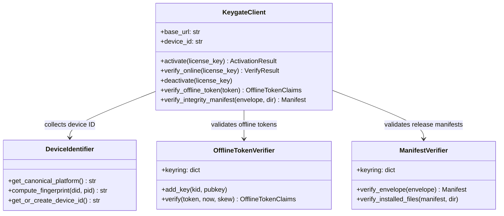
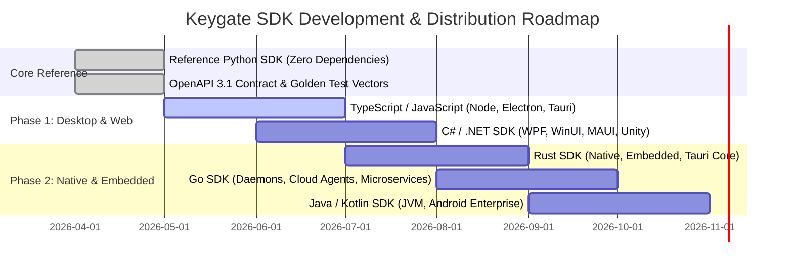

# Keygate Language-Independent Client Integration Strategy & SDK Architecture

> **Status:** Approved Architecture & Implementation Standard  
> **Target Audience:** Cross-Platform Client SDK Authors, API Integrators, Systems Architects  
> **Applies to:** Keygate Core Licensing, Release Distribution, and Supply Chain Integrity  
> **Attribution:** *Powered by Keygate* (AGPL v3 Section 7(b))

---

## 1. Executive Summary & Design Principles

Keygate is designed as an **API-first, language-independent licensing and software distribution platform**. The server API and protocol are authoritative; **no single programming language or client runtime is required or favored**.

Any client capable of performing standard HTTPS requests can integrate with Keygate using raw HTTP calls or via language-specific client SDKs.

### Core Architectural Axioms

1. **Server Authority:** The server authoritatively enforces license activation limits, subscription expiry, quota consumption, and rate limits. Client SDKs provide convenience and local offline verification, but never replace server-side enforcement.
2. **Zero Client Secrets:** SDKs and distributed client applications **never** store administrator credentials, private signing keys, or server secrets. All client credentials are restricted to the customer's `license_key` or signed public tokens.
3. **No Language Lock-in:** The OpenAPI specification (`docs/openapi.yaml`) is the single source of truth for the HTTP contract. Integrators may use official SDKs, community SDKs, or raw HTTPS clients.
4. **Platform-Realistic Device Identity:** Hardware fingerprinting capabilities vary radically between a sandboxed browser, a Windows desktop app, an iOS device, and a Linux container. The protocol decouples generic licensing operations from platform-specific identity providers.
5. **Fail-Closed Verification:** Offline entitlement tokens and release integrity manifests use standard Ed25519 (RFC 8032) digital signatures. If verification fails or a key is untrusted, clients fail closed.

---

## 2. The Authoritative API Contract

### 2.1 The Standard Response Envelope

Every endpoint under `/api/v1/` returns a uniform JSON envelope:

```json
// Success Response (HTTP 200 / 201)
{
  "success": true,
  "data": { ... }
}

// Error Response (HTTP 4xx / 5xx)
{
  "success": false,
  "error": {
    "code": "ACTIVATION_LIMIT",
    "message": "Activation limit reached for this license (3/3 active)",
    "details": { "current": 3, "max": 3 }
  }
}
```

#### Envelope Rules for Integrators & SDK Authors
- `data` and `error` are mutually exclusive; exactly one is present.
- `error.code` is an uppercase `SCREAMING_SNAKE_CASE` string. **Every error code maps 1:1 to a single fixed HTTP status**, allowing clients to branch on `code` and determine retry behavior from `http_status`.
- `error.details` is an optional dictionary providing structured context (such as quota caps or validation fields).
- Unmatched paths or HTTP methods return `404 NOT_FOUND` inside the same envelope, simplifying error decoding.

### 2.2 Existence-Oracle Hardening

To prevent malicious enumeration of valid license keys, `/license/verify` and `/license/deactivate` collapse all invalid states (license not found, expired, revoked, wrong product, or wrong device) into a uniform `404 LICENSE_NOT_FOUND`. Legitimate customers discover billing and subscription status via email notifications and the customer self-service portal, not through client enumeration probes.

### 2.3 Safe Retries via Idempotency

Write endpoints (`/license/activate`, `/license/usage`, `/license/floating/checkout`) support the `Idempotency-Key` HTTP header. 
- Retrying with the same `Idempotency-Key` and identical request body within 24 hours returns the cached response with the `Idempotent-Replayed: true` header.
- Reusing the same key with a different body returns `422 IDEMPOTENCY_KEY_CONFLICT`.

---

## 3. Raw HTTPS API Integration (No SDK Required)

Developers can integrate Keygate directly into any programming environment without third-party dependencies.

### 3.1 Activating a License (cURL)

```bash
curl -X POST "https://licensing.example.com/api/v1/license/activate" \
  -H "Content-Type: application/json" \
  -H "Idempotency-Key: $(uuidgen)" \
  -d '{
    "license_key": "KG-ABCD2345-EFGH6789-IJKL1234-MNOP5678",
    "identifier": "kgid:v1:darwin:5581b5a7b290e096fdea9b19916561e13d15fc983a9b57c53a9e5ad91f29f4b7",
    "identifier_type": "device",
    "label": "MacBook Pro Workstation"
  }'
```

**Success Response (HTTP 200):**
```json
{
  "success": true,
  "data": {
    "license_id": "lic_99a8b7c6d5e4",
    "token": "eyJsaWQiOiJsaWNfOTlhOGI3YzZkNWU0In0.MhE41NfU0yTq20q9HqKjE...",
    "status": "active",
    "product_id": "prod_cad_designer",
    "valid_until": "2027-04-18T09:00:00Z",
    "features": { "3d_rendering": true, "max_resolution": 8192 }
  }
}
```

### 3.2 Verifying an Online License (cURL)

```bash
curl -X POST "https://licensing.example.com/api/v1/license/verify" \
  -H "Content-Type: application/json" \
  -d '{
    "license_key": "KG-ABCD2345-EFGH6789-IJKL1234-MNOP5678",
    "identifier": "kgid:v1:darwin:5581b5a7b290e096fdea9b19916561e13d15fc983a9b57c53a9e5ad91f29f4b7"
  }'
```

### 3.3 Deactivating a Device (cURL)

```bash
curl -X POST "https://licensing.example.com/api/v1/license/deactivate" \
  -H "Content-Type: application/json" \
  -d '{
    "license_key": "KG-ABCD2345-EFGH6789-IJKL1234-MNOP5678",
    "identifier": "kgid:v1:darwin:5581b5a7b290e096fdea9b19916561e13d15fc983a9b57c53a9e5ad91f29f4b7"
  }'
```

### 3.4 Raw Integration Examples Across Languages

````carousel
```python
# Python raw integration (standard library urllib)
import json, urllib.request

req = urllib.request.Request(
    "https://licensing.example.com/api/v1/license/verify",
    data=json.dumps({"license_key": "KG-DEMO", "identifier": "dev-01"}).encode(),
    headers={"Content-Type": "application/json"}
)
with urllib.request.urlopen(req) as resp:
    result = json.loads(resp.read().decode())
    print("Status:", result["data"]["status"])
```
<!-- slide -->
```typescript
// TypeScript / JavaScript raw integration (fetch)
const resp = await fetch("https://licensing.example.com/api/v1/license/verify", {
  method: "POST",
  headers: { "Content-Type": "application/json" },
  body: JSON.stringify({ license_key: "KG-DEMO", identifier: "dev-01" })
});
const envelope = await resp.json();
if (envelope.success) {
  console.log("Status:", envelope.data.status);
} else {
  console.error("Error:", envelope.error.code);
}
```
<!-- slide -->
```csharp
// C# / .NET raw integration (HttpClient)
using System.Net.Http.Json;

var client = new HttpClient { BaseAddress = new Uri("https://licensing.example.com") };
var response = await client.PostAsJsonAsync("/api/v1/license/verify", new {
    license_key = "KG-DEMO",
    identifier = "dev-01"
});
var envelope = await response.Content.ReadFromJsonAsync<KeygateEnvelope<VerifyData>>();
```
<!-- slide -->
```go
// Go raw integration (net/http)
body, _ := json.Marshal(map[string]string{"license_key": "KG-DEMO", "identifier": "dev-01"})
resp, err := http.Post("https://licensing.example.com/api/v1/license/verify", "application/json", bytes.NewReader(body))
// decode envelope...
```
````

---

## 4. Platform-Specific Device Identification Matrix

Device identification serves to track allocated license seats and detect unauthorized multi-machine duplication. Because hardware characteristics and privacy boundaries differ across operating systems and runtimes, SDKs must **never assume equivalent fingerprinting APIs across platforms**.

| Execution Environment | Primary Identifier Sources | Local Persistence | Spoofing Resistance | Stability Across OS Updates | Privacy / Sandboxing Constraints |
|---|---|---|---|---|---|
| **macOS Desktop** | `ioreg` `IOPlatformUUID` or hardware serial via IOKit | macOS Keychain (encrypted) | High | High (survives OS updates; changes on motherboard replacement) | App Sandbox requires entitlement for hardware serials; `IOPlatformUUID` accessible. |
| **Windows Desktop** | Registry `MachineGuid` (`HKLM\SOFTWARE\Microsoft\Cryptography`) or SMBIOS UUID | Windows DPAPI or Credential Manager | High | Medium (survives OS upgrades; reset by sysprep or clean install) | Restricted user accounts can read `MachineGuid`; WMI may be disabled in enterprise lockdown. |
| **Linux Desktop / Server** | `/etc/machine-id` or `/var/lib/dbus/machine-id` | `~/.local/share/keygate` (chmod 0700) | Medium | High (persists until root regenerates machine-id) | Containers (Docker, Kubernetes) often share or regenerate machine-id on container launch. |
| **Web Browser (JS/Wasm)** | None (Hardware access blocked) | IndexedDB / LocalStorage persisted UUID (`crypto.randomUUID()`) | Low | Low (cleared on browser cookie/storage wipe or incognito) | Canvas/WebGL/Audio fingerprinting explicitly rejected due to browser anti-tracking defenses. |
| **Mobile (iOS)** | `UIDevice.current.identifierForVendor` | iOS Keychain (`kSecAttrAccessibleAfterFirstUnlock`) | High | High (persists across launches; resets if all vendor apps uninstalled) | Access to raw MAC address and IMEI strictly forbidden by Apple App Store policies. |
| **Mobile (Android)** | `Settings.Secure.ANDROID_ID` | Android Keystore / EncryptedSharedPreferences | Medium | Medium (resets on factory wipe or signing key change) | Non-resettable hardware IDs (MAC, IMEI) restricted to system apps starting in Android 10+. |
| **Cloud / Containers** | AWS Instance ID / GCP VM ID / Azure VM ID | Ephemeral or Mounted Volume GUID | Medium | Low in ephemeral serverless; High in persistent VMs | Cloned containers must use user-level licensing or floating license checkouts (`/license/floating`). |

---

## 5. Reference SDK (Python)

The Keygate repository provides a full-featured, zero-external-dependency reference SDK in [`sdk/python/`](file:///Users/aminshojaei/AndroidStudioProjects/keygate/sdk/python/).

### 5.1 Architecture of the Reference SDK



### 5.2 Minimal Sample Application

A standalone quickstart sample application is provided at [`sdk/python/examples/quickstart.py`](file:///Users/aminshojaei/AndroidStudioProjects/keygate/sdk/python/examples/quickstart.py). It demonstrates all five core workflows:
1. License Activation (`client.activate`)
2. Error Handling (`ActivationLimitError`, `LicenseNotFoundError`)
3. Online Verification (`client.verify_online`)
4. Local Offline Token Verification (`client.verify_offline_token`)
5. Application Integrity Manifest Verification (`client.verify_integrity_manifest`)

To execute the sample:
```bash
python3 sdk/python/examples/quickstart.py
```

### 5.3 Automated SDK Test Suite

The reference SDK includes comprehensive unit tests in [`sdk/python/tests/test_sdk.py`](file:///Users/aminshojaei/AndroidStudioProjects/keygate/sdk/python/tests/test_sdk.py) covering all token boundary conditions, device identity persistence, directory jail escapes, and error handling:
```bash
python3 sdk/python/tests/test_sdk.py
```

---

## 6. Multi-Language SDK Priorities & Roadmap

To maximize developer adoption while maintaining security rigor, client SDK development proceeds in prioritized phases based on actual repository target environments:



### Language Selection Rationale

1. **Priority 1: Reference Python SDK (`sdk/python`) — [COMPLETED]**
   - **Target:** Cross-platform scripts, automation pipelines, machine learning tooling, desktop CLI tools.
   - **Tech:** Zero-dependency Python standard library (`urllib`, `hashlib`, pure-Python Ed25519 fallback).
2. **Priority 2: TypeScript / JavaScript SDK (`@keygate/client`) — [PHASE 1]**
   - **Target:** Electron desktop apps, Tauri webviews, web SaaS integrations, Node.js backend services.
   - **Key Considerations:** Built-in `node:crypto` or Web Crypto API (`SubtleCrypto`); browser sandbox awareness (no raw filesystem or hardware calls).
3. **Priority 3: C# / .NET SDK (`Keygate.Client`) — [PHASE 1]**
   - **Target:** Windows desktop enterprise apps (WPF, WinUI 3), Unity game engines, cross-platform .NET MAUI.
   - **Key Considerations:** `System.Security.Cryptography`, Windows DPAPI device identity integration, NuGet package packaging.
4. **Priority 4: Rust SDK (`keygate-rs`) — [PHASE 2]**
   - **Target:** Native desktop software (Tauri backend), systems software, embedded devices.
   - **Key Considerations:** `ed25519-dalek`, zero-allocation streaming SHA-256, memory safety guarantees.
5. **Priority 5: Go SDK (`github.com/tabloy/keygate/sdk/go`) — [PHASE 2]**
   - **Target:** Cloud-native agents, daemon processes, DevOps tooling.
   - **Key Considerations:** Shares `pkg/integrity` algorithms natively with zero CGO.
6. **Priority 6: Java / Kotlin SDK (`app.keygate.client`) — [PHASE 2]**
   - **Target:** Android mobile apps, enterprise Java backend applications.
   - **Key Considerations:** Android Keystore integration, BouncyCastle or Java 15+ Ed25519 primitives.
