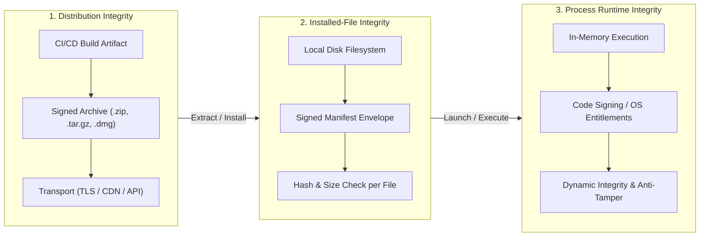
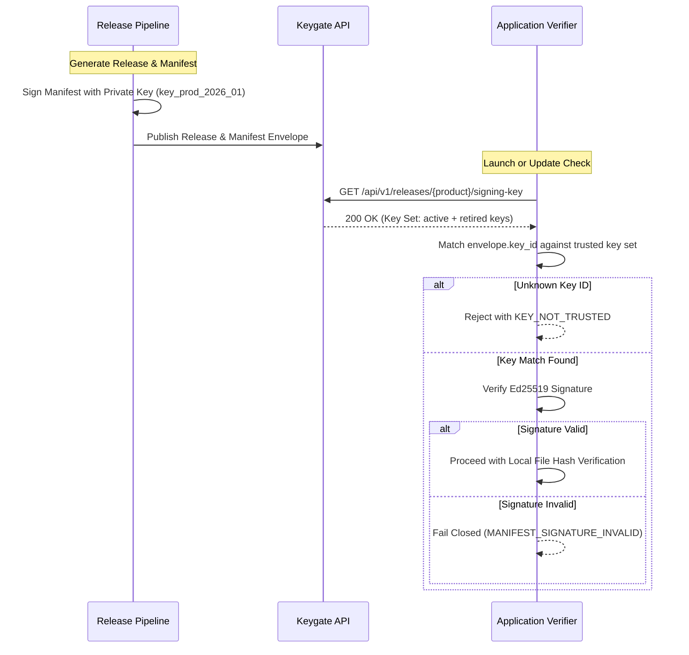

# Keygate Application Integrity Manifest Specification (v1)

> **Status:** Approved Architecture & Security Specification  
> **Target Audience:** Cross-Platform Client SDK Authors, Release Engineers, Security Architects  
> **Applies to:** Keygate Software Supply Chain Security & Integrity Verification Protocol  
> **Attribution:** *Powered by Keygate* (AGPL v3 Section 7(b))

---

## 1. Scope & Architectural Boundaries

Software integrity assurance spans multiple stages across the software development, distribution, and execution lifecycle. A failure to distinguish between these stages leads to false security assumptions.

The Keygate Application Integrity Manifest system delineates three distinct boundaries:



### 1.1 Scope Boundaries

1. **Release Artifact Integrity during Distribution:**
   - **Goal:** Protect downloaded release archives or installer packages in transit from the build pipeline or CDN to the customer's machine.
   - **Mechanism:** Transport Layer Security (TLS 1.3), Content-Disposition hashes, and signed container signatures (e.g., Sparkle Ed25519 signatures, Authenticode, Apple Notarization).
   - **Boundary Limit:** Verifying a downloaded zip/tarball guarantees only that the archive arrived intact. It does **not** verify whether local installer post-scripts, package extractors, or third-party file managers subsequently altered, omitted, or injected individual files on disk.

2. **Installed-File Integrity on Customer Host (This Specification):**
   - **Goal:** Deterministically verify that the collection of files extracted on the customer's filesystem exactly matches the author's intended release, free from unauthorized additions, modifications, corruptions, or deletions.
   - **Mechanism:** A cryptographically signed, canonical integrity manifest (`manifest.json` / `SignedEnvelope`) enumerating every protected relative file path, byte size, and SHA-256 digest.
   - **Boundary Limit:** File hashes on disk reflect static storage state. They do **not** protect against in-memory process tampering once an application binary is executing.

3. **Runtime Process Integrity:**
   - **Goal:** Ensure code executing in memory has not been hooked, patched, or injected by debuggers, memory scanners, or dynamic library injection (e.g., `LD_PRELOAD`, `DYLD_INSERT_LIBRARIES`).
   - **Mechanism:** Platform-specific operating system primitives (macOS Hardened Runtime, Windows Credential Guard / Code Integrity, Linux seccomp/eBPF, hardware enclave attestation).
   - **Boundary Limit:** Static file manifests cannot prevent runtime memory modification. Static manifests provide the foundational verification gate prior to or during execution, but are not an in-memory anti-tampering engine.

---

## 2. Manifest Format & Enveloped Signature Design

To eliminate serialization ambiguities across multiple programming languages (Go, Python, Rust, C#, TypeScript/Node.js, Swift, C++), the integrity specification uses an **enveloped detached format**.

The signed envelope wraps an unpadded Base64URL-encoded canonical payload together with an Ed25519 digital signature.

### 2.1 Signed Envelope Schema (`SignedEnvelope`)

```json
{
  "format": "keygate-manifest-envelope-v1",
  "algorithm": "ed25519",
  "key_id": "key_prod_2026_01",
  "payload": "eyJjcmVhdGVkX2F0IjoiMjAyNi0xMC0xOFQwODowMDowMFoiLCJmaWxlcyI6W3sicGF0aCI6ImJpbi9hcHAiLCJzaGEyNTYiOiI1NTgxYjVhN2IyOTBlMDk2ZmRlYTliMTk5MTY1NjFlMTNkMTVmYzk4M2E5YjU3YzUzYTllNWFkOTFmMjlmNGI3Iiwic2l6ZSI6MjA0OH1dfQ",
  "signature": "MhE41NfU0yTq20q9HqKjE...86chars..."
}
```

#### Envelope Fields

| Field | Type | Required | Description |
|---|---|---|---|
| `format` | `string` | **Yes** | Must be `"keygate-manifest-envelope-v1"`. Identifies the envelope specification version. |
| `algorithm` | `string` | **Yes** | Cryptographic signature algorithm. Must be `"ed25519"`. |
| `key_id` | `string` | **Yes** | Identifier of the public key authorized to verify this signature (matches `key_id` in manifest payload). |
| `payload` | `string` | **Yes** | Base64URL-encoded (RFC 4648 §5, unpadded) bytes of the canonical JSON manifest. |
| `signature` | `string` | **Yes** | Base64URL-encoded (unpadded) 64-byte Ed25519 digital signature over the decoded payload bytes. |

### 2.2 Manifest Payload Schema (`Manifest`)

When decoded, the canonical payload represents the manifest structure:

```json
{
  "manifest_version": "1.0",
  "product_id": "com.example.desktop",
  "release_id": "1.4.0",
  "platform": "darwin",
  "architecture": "arm64",
  "created_at": "2026-10-18T08:00:00Z",
  "key_id": "key_prod_2026_01",
  "files": [
    {
      "path": "bin/myapp",
      "sha256": "5581b5a7b290e096fdea9b19916561e13d15fc983a9b57c53a9e5ad91f29f4b7",
      "size": 24576120,
      "executable": true
    },
    {
      "path": "lib/libengine.dylib",
      "sha256": "e3b0c44298fc1c149afbf4c8996fb92427ae41e4649b934ca495991b7852b855",
      "size": 4194304
    },
    {
      "path": "resources/config.json",
      "sha256": "4b227777d4dd1fc61c6f884f48641d02b4d121d3fd328cb08b5531fcacdabf8a",
      "size": 1024
    }
  ],
  "metadata": {
    "git_commit": "7f8b91c0e3",
    "builder": "github-actions-runner-04"
  }
}
```

#### Manifest Fields

| Field | Type | Required | Description |
|---|---|---|---|
| `manifest_version` | `string` | **Yes** | Version of the manifest schema. Currently `"1.0"`. |
| `product_id` | `string` | **Yes** | Identifier of the application or product (e.g. `com.example.app` or `keygate-agent`). |
| `release_id` | `string` | **Yes** | Semantic version or release tag (e.g. `1.4.0`). |
| `platform` | `string` | No | Target OS platform (`darwin`, `windows`, `linux`, `android`, `ios`, `all`). |
| `architecture` | `string` | No | Target CPU architecture (`x86_64`, `arm64`, `universal`, `all`). |
| `created_at` | `string` | **Yes** | ISO 8601 / RFC 3339 UTC timestamp when the manifest was generated. |
| `key_id` | `string` | **Yes** | Public key identifier used for signature generation. Must match envelope `key_id`. |
| `files` | `array[FileEntry]` | **Yes** | Sorted array of protected file entries. |
| `metadata` | `map[string]string`| No | Optional non-authoritative build metadata. |

#### FileEntry Fields

| Field | Type | Required | Description |
|---|---|---|---|
| `path` | `string` | **Yes** | Normalized POSIX relative path from root directory. |
| `sha256` | `string` | **Yes** | Lowercase 64-character hexadecimal SHA-256 cryptographic digest. |
| `size` | `integer` | **Yes** | File size in bytes (non-negative integer). |
| `executable` | `boolean` | No | Set to `true` if file has POSIX executable bits set (mode `0111`). |

---

## 3. Deterministic Canonical Serialization (RFC 8785)

Different programming language JSON serializers format whitespace, floating-point numbers, and object key ordering differently. If a signature were computed directly over an unconstrained JSON string, cross-platform verification would break whenever a parser reformatted a single space.

To guarantee cryptographic determinism:

1. **RFC 8785 JSON Canonicalization Scheme (JCS):**
   - Object keys are sorted lexicographically by UTF-16 code units.
   - Whitespace between tokens is completely removed (`:` and `,` without padding).
   - Strings use standard JSON escaping with uppercase hex escapes where required.
   - Numbers follow ECMAScript 6 / RFC 8785 rules.
2. **Deterministic File Ordering:**
   - File entries in `files` MUST be sorted lexicographically by their `path` attribute using standard byte (ASCII/UTF-8) collation before serialization.
3. **Envelope Base64URL Wrapping:**
   - The canonical JSON byte slice is encoded using standard RFC 4648 Base64URL without padding characters (`=`).
   - The signature is calculated directly over these canonical bytes.
   - Verifiers decode `payload` directly to bytes and verify the Ed25519 signature before deserializing the JSON object. This ensures that even if the verifier's local JSON parser is non-canonical, signature validation remains 100% reliable.

---

## 4. Path Traversal & Filesystem Normalization

Manifests are designed to protect arbitrary files deployed to a destination directory. If malicious or malformed relative paths were accepted, a crafted manifest could overwrite or verify arbitrary files outside the installation root (e.g. `../../../../etc/passwd` or `..\..\Windows\System32`).

### 4.1 Strict Path Validation Rules

Every path in `FileEntry.path` MUST satisfy all of the following rules:

1. **Relative Paths Only:**
   - Leading slashes (`/` or `\`) are strictly forbidden.
   - Drive letter prefixes (e.g. `C:`, `D:`) are strictly forbidden.
2. **Forward Slashes Only:**
   - All directory separators must be standard POSIX forward slashes (`/`).
   - Backslashes (`\`) are forbidden regardless of whether the generator or verifier is running on Windows.
3. **No Traversal Tokens:**
   - Path components equal to `..` (parent directory) or `.` (current directory) are strictly forbidden.
   - Sequences like `../`, `/..`, `/../`, or trailing `/..` are strictly rejected.
4. **No Empty Path Components:**
   - Consecutive slashes (`//`) are forbidden.
5. **No Trailing Slashes:**
   - Paths must refer to discrete files, not directories (e.g., `dir/` is invalid; `dir/file.txt` is valid).
6. **No Control Characters or Windows Prohibited Characters:**
   - ASCII control characters (`\x00` through `\x1F`) are forbidden.
   - Dangerous characters (`:`, `*`, `?`, `"`, `<`, `>`, `|`) are forbidden to ensure safe cross-platform extraction.
7. **Filesystem Jail Constraint:**
   - During verification, the verifier must resolve the path against the target directory jail (`os.DirFS` or `filepath.Clean`) and verify using lexical prefix matching that the canonical target path remains strictly within the target root.

---

## 5. Cryptographic Signature & Key Rotation

### 5.1 Ed25519 Signature Scheme

- **Algorithm:** Ed25519 (PureEdDSA using SHA-512 and Curve25519 per RFC 8032).
- **Rationale:** High performance, immune to cache-timing attacks, fixed 64-byte signature size, fixed 32-byte public key size, no nonce generation failure modes.
- **Payload Input:** Raw canonical UTF-8 bytes decoded from `envelope.payload`.

### 5.2 Key Separation Principles

- **No Private Keys in Client Software:** Private signing keys MUST never be compiled into client binaries, stored in application repositories, or exposed via public APIs.
- **CI/CD Signing:** Signing occurs during the release build step on an isolated, authenticated runner or dedicated signing service (e.g., AWS KMS, HashiCorp Vault, YubiKey HSM).
- **Public Key Distribution:** Public verification keys (32-byte Ed25519 public keys) are safely embedded in client applications, distributed via signed update channels, or fetched from the Keygate Release API (`GET /api/v1/releases/:product_slug/signing-key`).

### 5.3 Key Rotation Lifecycle

Keys are identified by a unique `key_id` (e.g., `key_prod_2026_01`).



When rotating keys:
1. The new public key is provisioned with a new `key_id` (e.g. `key_prod_2027_01`).
2. The Keygate API returns both active and recently retired keys with status metadata (`active`, `retired`, `revoked`).
3. If a key is marked `revoked`, client verifiers immediately reject manifests signed by that key.

---

## 6. Threat Model & Security Limitations

Integrity manifests provide a strong, deterministic verification gate, but security architects must understand their operational boundaries.

### 6.1 Protected Threats

| Threat | Mitigation |
|---|---|
| **Man-in-the-Middle (MitM) Tampering** | Manifest envelope signature fails if any file hash or metadata is modified in transit. |
| **Incomplete or Corrupted Downloads** | File size and SHA-256 checks catch truncated, damaged, or dropped files. |
| **Malicious File Injection** | Any added file not present in the manifest (when strict scanning is enabled) is flagged. |
| **Path Traversal Attacks** | Strict parser rules reject any attempt to write outside the installation root. |
| **Accidental or Malicious Local Alteration** | Verification detects modified `.dll`, `.dylib`, or executable binaries on disk. |

### 6.2 Security Limitations & Non-Goals

> [!WARNING]
> **Adversary with Local Administrative or Root Access:**  
> If an attacker has write access to the client machine, they can:
> 1. Replace the local application binary or memory to bypass the verifier call entirely.
> 2. Patch the embedded public verification key in memory or in the binary.
> 3. Intercept kernel filesystem calls via rootkits or kernel drivers.
>
> Application integrity manifests verify static file consistency prior to trust establishment. They do **not** replace hardware roots of trust (TPM, Secure Boot) or operating system-enforced code signature enforcement (macOS Gatekeeper, Windows SmartScreen).

> [!NOTE]
> **Dynamic Runtime Anti-Tampering:**  
> Static SHA-256 hashes cannot prevent memory scanning, dynamic code injection (`ptrace`, Frida, Cheat Engine), or debugger attachment once the binary is loaded into RAM. Runtime defenses require dedicated platform controls.
