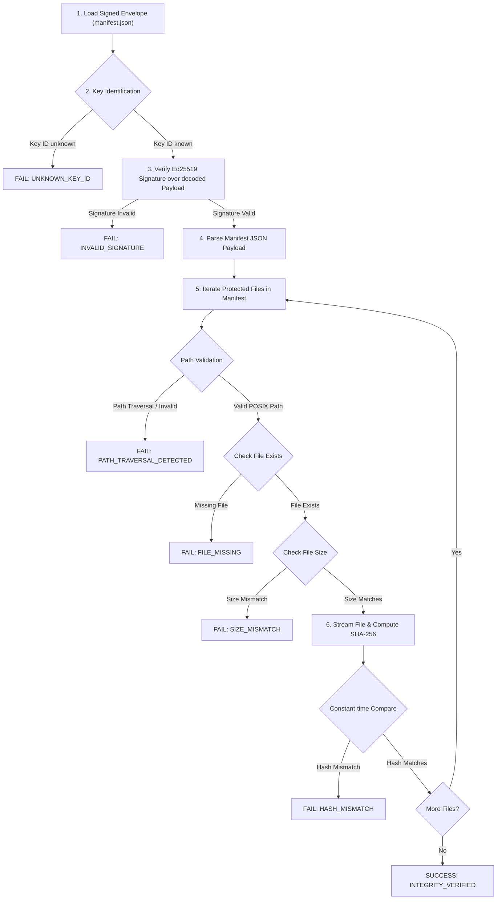

# Keygate Application Integrity Verification Protocol & Implementation Guide

> **Status:** Approved Architecture & Reference Verification Guide  
> **Target Audience:** Cross-Platform Client SDK Authors, Application Developers, Systems Engineers  
> **Applies to:** Keygate Application Integrity Manifest Protocol v1  
> **Attribution:** *Powered by Keygate* (AGPL v3 Section 7(b))

---

## 1. Overview & Verification Protocol

The Keygate Application Integrity Verification protocol enables client applications written in any programming language to verify the integrity of their installed files against an authoritative, Ed25519-signed manifest.

Verification executes in six discrete phases:



---

## 2. Step-by-Step Verification Procedure

### Step 1: Retrieve Envelope & Public Key

- **Local / Bundled:** Read `manifest.json` from the application directory.
- **Remote / API:** Download the manifest envelope from Keygate's release artifact distribution endpoint.
- **Public Key Resolution:**
  - Retrieve the trusted public key corresponding to `envelope.key_id`.
  - Keys may be pinned in application code or fetched via `GET /api/v1/releases/:product_slug/signing-key`.
  - If `key_id` is unrecognized or revoked, abort verification immediately.

### Step 2: Cryptographic Signature Verification

1. Extract `envelope.payload` and `envelope.signature`.
2. Decode both strings using **RFC 4648 Base64URL without padding** (`-` and `_` characters, no trailing `=`).
3. Verify the 64-byte Ed25519 signature over the decoded payload bytes using the 32-byte public key.
4. **Fail closed:** If signature verification fails, do not inspect any files. Abort immediately.

### Step 3: Deserialization & Header Validation

1. Deserialize the verified payload bytes as JSON.
2. Validate that `manifest.manifest_version` equals `"1.0"`. If unsupported, reject.
3. Validate that `manifest.product_id` matches the expected product.
4. Ensure `manifest.key_id` matches `envelope.key_id`.

### Step 4: Secure Path Resolution & Directory Jail

For each entry in `manifest.files`:
1. Enforce strict POSIX relative path rules:
   - Reject paths starting with `/` or containing Windows drive letters (`C:`).
   - Reject backslashes (`\`).
   - Reject path segments containing `..` or `.`.
   - Reject empty path segments (`//`) and control characters (`\x00`–`\x1F`).
2. Resolve target path:
   ```text
   resolved_path = filesystem_join(installation_root, file.path)
   ```
3. Confirm that the normalized absolute target path is prefixed with `installation_root`. If not, abort with `PATH_TRAVERSAL_DETECTED`.

### Step 5: File Size Check

1. Query filesystem metadata (`stat`).
2. If the file does not exist, record `FILE_MISSING`.
3. Compare `stat.size` with `file.size`. If they differ, record `SIZE_MISMATCH`. (Checking size first avoids calculating SHA-256 hashes over truncated or swollen files).

### Step 6: Streaming Cryptographic Hash Calculation

1. Stream the file in chunks (e.g. 64 KB buffers) through a SHA-256 hashing context. Do not read multi-gigabyte binaries entirely into memory.
2. Format the calculated digest as a 64-character lowercase hex string.
3. Compare the computed hex digest with `file.sha256` using **constant-time byte comparison** (`crypto/subtle.ConstantTimeCompare` or equivalent).
4. If hashes do not match, record `HASH_MISMATCH`.

---

## 3. Error Classification & Status Codes

| Error Code | Description | Severity | Action |
|---|---|---|---|
| `UNKNOWN_KEY_ID` | Manifest signed with unrecognized `key_id`. | Critical | Reject release; update application or fetch new keys. |
| `KEY_REVOKED` | Key ID has been marked as compromised or revoked. | Critical | Reject immediately. |
| `INVALID_SIGNATURE` | Ed25519 signature does not match canonical payload. | Critical | Abort. Envelope tampered in transit or disk. |
| `UNSUPPORTED_VERSION` | Manifest schema version is unsupported. | High | Prompt customer to update application. |
| `PATH_TRAVERSAL_DETECTED` | Entry path attempts directory escape or illegal syntax. | Critical | Abort immediately. Malicious manifest. |
| `FILE_MISSING` | Protected file listed in manifest not found on disk. | High | Prompt for application reinstall or repair. |
| `SIZE_MISMATCH` | File size on disk does not match manifest. | High | Flag tampered/corrupted file. |
| `HASH_MISMATCH` | Computed SHA-256 differs from expected digest. | Critical | Flag unauthorized modification or binary tampering. |

---

## 4. Multi-Language Implementation Reference

### 4.1 Go Implementation (Standard Library)

```go
package main

import (
	"crypto/ed25519"
	"crypto/sha256"
	"crypto/subtle"
	"encoding/base64"
	"encoding/hex"
	"encoding/json"
	"fmt"
	"io"
	"os"
	"path/filepath"
	"strings"
)

type SignedEnvelope struct {
	Format    string `json:"format"`
	Algorithm string `json:"algorithm"`
	KeyID     string `json:"key_id"`
	Payload   string `json:"payload"`
	Signature string `json:"signature"`
}

type Manifest struct {
	ManifestVersion string      `json:"manifest_version"`
	ProductID       string      `json:"product_id"`
	ReleaseID       string      `json:"release_id"`
	Files           []FileEntry `json:"files"`
}

type FileEntry struct {
	Path   string `json:"path"`
	SHA256 string `json:"sha256"`
	Size   int64  `json:"size"`
}

func VerifyRelease(installDir string, envelopeJSON []byte, trustedPublicKey ed25519.PublicKey) error {
	var env SignedEnvelope
	if err := json.Unmarshal(envelopeJSON, &env); err != nil {
		return fmt.Errorf("envelope unmarshal: %w", err)
	}

	rawPayload, err := base64.RawURLEncoding.DecodeString(env.Payload)
	if err != nil {
		return fmt.Errorf("decode payload: %w", err)
	}
	rawSig, err := base64.RawURLEncoding.DecodeString(env.Signature)
	if err != nil {
		return fmt.Errorf("decode signature: %w", err)
	}

	if !ed25519.Verify(trustedPublicKey, rawPayload, rawSig) {
		return fmt.Errorf("cryptographic signature verification failed")
	}

	var m Manifest
	if err := json.Unmarshal(rawPayload, &m); err != nil {
		return fmt.Errorf("parse manifest payload: %w", err)
	}

	for _, fe := range m.Files {
		// Strict path validation
		if strings.Contains(fe.Path, "..") || strings.HasPrefix(fe.Path, "/") || strings.Contains(fe.Path, "\\") {
			return fmt.Errorf("path traversal rejected: %s", fe.Path)
		}

		fullPath := filepath.Join(installDir, filepath.FromSlash(fe.Path))
		info, err := os.Stat(fullPath)
		if err != nil {
			return fmt.Errorf("missing file: %s", fe.Path)
		}
		if info.Size() != fe.Size {
			return fmt.Errorf("size mismatch for %s: got %d, want %d", fe.Path, info.Size(), fe.Size)
		}

		f, err := os.Open(fullPath)
		if err != nil {
			return err
		}
		hasher := sha256.New()
		if _, err := io.Copy(hasher, f); err != nil {
			f.Close()
			return err
		}
		f.Close()

		calcDigest := hex.EncodeToString(hasher.Sum(nil))
		if subtle.ConstantTimeCompare([]byte(calcDigest), []byte(fe.SHA256)) != 1 {
			return fmt.Errorf("digest mismatch for %s: got %s, want %s", fe.Path, calcDigest, fe.SHA256)
		}
	}
	return nil
}
```

### 4.2 Python Implementation

```python
import base64
import hashlib
import json
import os
from cryptography.hazmat.primitives.asymmetric.ed25519 import Ed25519PublicKey

def verify_release(install_dir: str, envelope_path: str, trusted_pubkey_bytes: bytes) -> bool:
    with open(envelope_path, 'r', encoding='utf-8') as f:
        env = json.load(f)

    # Base64URL decode without padding
    payload_bytes = base64.urlsafe_b64decode(env['payload'] + '===')
    sig_bytes = base64.urlsafe_b64decode(env['signature'] + '===')

    # Verify Ed25519 signature
    pubkey = Ed25519PublicKey.from_public_bytes(trusted_pubkey_bytes)
    pubkey.verify(sig_bytes, payload_bytes)

    manifest = json.loads(payload_bytes.decode('utf-8'))
    clean_install_root = os.path.realpath(install_dir)

    for entry in manifest['files']:
        rel_path = entry['path']
        if '..' in rel_path or rel_path.startswith('/') or '\\' in rel_path:
            raise ValueError(f"Path traversal detected: {rel_path}")

        full_path = os.path.realpath(os.path.join(clean_install_root, rel_path))
        if not full_path.startswith(clean_install_root + os.sep):
            raise ValueError(f"Path escapes jail: {rel_path}")

        if not os.path.exists(full_path):
            raise FileNotFoundError(f"Missing file: {rel_path}")

        if os.path.getsize(full_path) != entry['size']:
            raise ValueError(f"Size mismatch: {rel_path}")

        hasher = hashlib.sha256()
        with open(full_path, 'rb') as f:
            while chunk := f.read(65536):
                hasher.update(chunk)

        if hasher.hexdigest().lower() != entry['sha256'].lower():
            raise ValueError(f"Hash mismatch: {rel_path}")

    return True
```

### 4.3 Node.js / TypeScript Implementation

```typescript
import * as crypto from 'node:crypto';
import * as fs from 'node:fs';
import * as path from 'node:path';

interface SignedEnvelope {
  format: string;
  algorithm: string;
  key_id: string;
  payload: string;
  signature: string;
}

interface Manifest {
  manifest_version: string;
  files: Array<{ path: string; sha256: string; size: number }>;
}

export function verifyRelease(installDir: string, envelopeJson: string, rawPublicKey: Buffer): boolean {
  const env: SignedEnvelope = JSON.parse(envelopeJson);
  const payloadBytes = Buffer.from(env.payload, 'base64url');
  const signatureBytes = Buffer.from(env.signature, 'base64url');

  const pubKey = crypto.createPublicKey({
    key: Buffer.concat([Buffer.from('302a300506032b6570032100', 'hex'), rawPublicKey]),
    format: 'der',
    type: 'spki',
  });

  const valid = crypto.verify(null, payloadBytes, pubKey, signatureBytes);
  if (!valid) throw new Error('Invalid signature');

  const manifest: Manifest = JSON.parse(payloadBytes.toString('utf-8'));
  const realInstallDir = fs.realpathSync(installDir);

  for (const entry of manifest.files) {
    if (entry.path.includes('..') || entry.path.startsWith('/') || entry.path.includes('\\')) {
      throw new Error(`Path traversal rejected: ${entry.path}`);
    }
    const fullPath = path.resolve(installDir, entry.path);
    if (!fullPath.startsWith(realInstallDir + path.sep)) {
      throw new Error(`Directory jail escape: ${entry.path}`);
    }
    const stat = fs.statSync(fullPath);
    if (stat.size !== entry.size) throw new Error(`Size mismatch: ${entry.path}`);

    const fileBuffer = fs.readFileSync(fullPath);
    const hash = crypto.createHash('sha256').update(fileBuffer).digest('hex');
    if (hash !== entry.sha256) throw new Error(`Hash mismatch: ${entry.path}`);
  }
  return true;
}
```

### 4.4 Rust Implementation

```rust
use ed25519_dalek::{Signature, VerifyingKey};
use base64::{engine::general_purpose::URL_SAFE_NO_PAD, Engine as _};
use sha2::{Digest, Sha256};
use std::fs::File;
use std::io::{Read, BufReader};
use std::path::Path;

pub fn verify_release(
    install_dir: &Path,
    envelope_json: &str,
    public_key_bytes: &[u8; 32],
) -> Result<(), Box<dyn std::error::Error>> {
    let env: serde_json::Value = serde_json::from_str(envelope_json)?;
    let payload_str = env["payload"].as_str().ok_or("missing payload")?;
    let sig_str = env["signature"].as_str().ok_or("missing signature")?;

    let payload = URL_SAFE_NO_PAD.decode(payload_str)?;
    let sig_bytes = URL_SAFE_NO_PAD.decode(sig_str)?;

    let verifying_key = VerifyingKey::from_bytes(public_key_bytes)?;
    let signature = Signature::from_bytes(sig_bytes.as_slice().try_into()?)?;

    verifying_key.verify_strict(&payload, &signature)?;

    let manifest: serde_json::Value = serde_json::from_slice(&payload)?;
    let files = manifest["files"].as_array().ok_or("missing files array")?;

    for entry in files {
        let rel_path = entry["path"].as_str().ok_or("missing path")?;
        if rel_path.starts_with('/') || rel_path.contains("..") || rel_path.contains('\\') {
            return Err(format!("path traversal rejected: {}", rel_path).into());
        }

        let full_path = install_dir.join(rel_path);
        let metadata = std::fs::metadata(&full_path)?;
        let expected_size = entry["size"].as_u64().ok_or("missing size")?;
        if metadata.len() != expected_size {
            return Err(format!("size mismatch: {}", rel_path).into());
        }

        let mut file = BufReader::new(File::open(&full_path)?);
        let mut hasher = Sha256::new();
        let mut buffer = [0u8; 65536];
        loop {
            let count = file.read(&mut buffer)?;
            if count == 0 { break; }
            hasher.update(&buffer[..count]);
        }
        let calculated = hex::encode(hasher.finalize());
        let expected = entry["sha256"].as_str().ok_or("missing sha256")?;
        if calculated != expected {
            return Err(format!("hash mismatch: {}", rel_path).into());
        }
    }

    Ok(())
}
```

---

## 5. Offline & Air-Gapped Verification

For secure offline environments:
1. Embed the trusted Ed25519 public key byte literal in the client binary.
2. Bundle the signed `manifest.json` envelope inside the application distribution installer or directory root.
3. During first run or startup self-test, verify `manifest.json` against the local directory without initiating network requests.
4. If dynamic updates are enabled, periodically query the Keygate Release API for key status updates and revoked keys whenever network connectivity is available.
