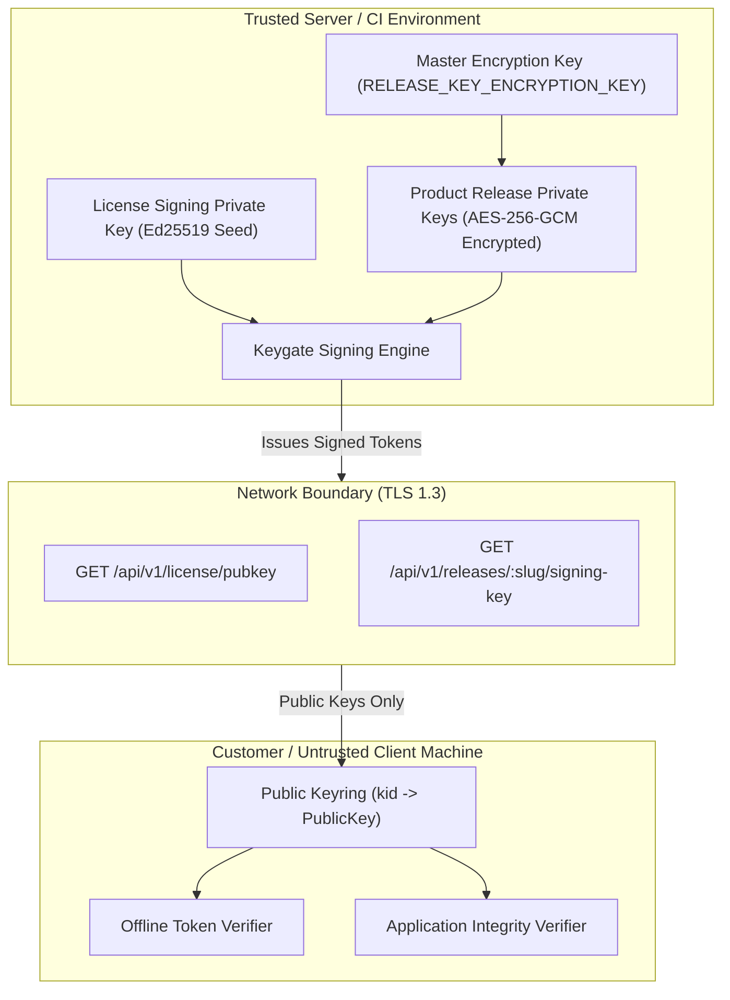

# Keygate Cryptographic Key Management Architecture

> **Status:** Approved Security Architecture & Operational Runbook  
> **Target Audience:** Security Engineers, DevOps / SRE, Cryptography Architects, System Administrators  
> **Applies to:** Keygate Core Licensing, Release Signing, and Data Encryption Subsystems  
> **Attribution:** *Powered by Keygate* (AGPL v3 Section 7(b))

---

## 1. Cryptographic Key Inventory & Classification

Keygate maintains strict cryptographic isolation across all functional boundaries. Keys used for license entitlement signing, software distribution artifact verification, session authentication, and database at-rest encryption use distinct algorithms, key sizes, and lifecycle policies.

| Key Identifier / Name | Algorithm | Generation Mechanism | Storage & Protection | Exposure Scope | Rotation Impact |
|---|---|---|---|---|---|
| **License Token Signing Key** (`LICENSE_SIGNING_KEY`) | **Ed25519** (RFC 8032) | `openssl rand -hex 32` (Seed) | Server environment variable or KMS; derives private/public keypair on boot | **Server-only.** Public half served via `GET /api/v1/license/pubkey` (+`kid`) | Old tokens verify against retired key during overlap window (`max_offline_ttl`); new tokens use new `kid`. |
| **Product Release Signing Keys** (`release_signing_keys`) | **Ed25519** (RFC 8032) | `ed25519.GenerateKey(rand.Reader)` | Encrypted at rest in DB via AES-256-GCM (**AAD = product_id**); private key `json:"-"` | **Server-only.** Public key exposed via `/releases/:slug/signing-key`, PEM, or Tauri pubkey | Updaters follow new `kid`; re-signing policy refuses modified content. |
| **Master Storage Key** (`RELEASE_KEY_ENCRYPTION_KEY`) | **AES-256-GCM** | 32 cryptographically random bytes (64 hex characters) | Server environment / Cloud Secret Manager | **Server-only.** Never logged, transmitted, or derived | Requires offline database re-encryption job if changed. |
| **JWT Session Secret** (`JWT_SECRET`) | **HMAC-SHA256** | $\ge 32$ random characters | Server environment | **Server-only.** | Drops active admin web sessions; users re-authenticate cleanly. |
| **API Authentication Keys** (`kg_live_...`) | **SHA-256** | 24 random bytes (192 bits entropy) | Salted SHA-256 hash stored in DB; plaintext shown once at creation | Customer API clients | Instant revocation; no grace period. |
| **Webhook Secrets** | **HMAC-SHA256** | 32 random bytes (hex) | Stored in DB; shared with webhook receiver | Shared with tenant endpoint | Receiver updates secret; dual-secret drain supported. |

---

## 2. Signing Architecture & Isolation Guarantees

### 2.1 Complete Asymmetric Separation



1. **Zero Client Secrets:**
   - Private signing keys **never leave the trusted server environment**.
   - No private key is ever bundled into client installers, SDK binaries, or public container images.
   - Decompilation, memory dumping, or disassembly of a client binary yields only public verification keys.
2. **At-Rest Protection via AAD:**
   - Private keys in the database are encrypted using AES-256-GCM with Additional Authenticated Data (`AAD = product_id`). This cryptographically binds the encrypted key to its specific product row, preventing ciphertext-swap attacks between tenants.
   - Seeds in memory are explicitly zeroed after use where applicable.
3. **Strict Serialization Hiding:**
   - Database model fields storing encrypted private keys carry the `json:"-"` struct tag, guaranteeing that no API endpoint, log serializer, or debug dump will ever transmit key material over HTTP.

### 2.2 Administrative Authentication & Audit Trails

All operations affecting signing keys—including generation, rotation, export, and status modification—are strictly gated:

- **Authentication & RBAC:** Key administration requires an active session with the `owner` or `admin` role. General API keys (`licenses:write`, `releases:write`) are intentionally barred from managing signing keys.
- **Audit Logging:** Every administrative key mutation writes an immutable row to the `audit_logs` table:
  - `action = "admin.signing_key_created"`
  - `action = "admin.signing_key_rotated"`
  - `action = "admin.signing_key_deactivated"`
  - Records the authenticated admin user ID, source IP address, user agent, product ID, and affected Key ID (`kid`).

---

## 3. Four-Phase Key Rotation Choreography

Key rotation in a distributed, offline-capable licensing ecosystem must not invalidate valid tokens held by disconnected clients. Keygate implements a **four-phase rotation lifecycle with overlap epochs**.

```mermaid
sequenceDiagram
    participant Op as Administrator / CI
    participant KG as Keygate Backend
    participant SDK as Client Application (Online)
    participant Off as Client Application (Offline)

    Note over Op,KG: Phase 1: Key Generation & Registration
    Op->>KG: POST /admin/products/{id}/signing-key/rotate
    KG->>KG: Generate new Ed25519 Keypair (kid: key_2027_01)
    KG->>KG: Set key_2027_01 to Active; transition key_2026_01 to Retired
    KG->>KG: Record audit log (admin.signing_key_rotated)

    Note over KG,SDK: Phase 2: Dual-Key Publication
    SDK->>KG: GET /license/pubkey or GET /releases/{slug}/signing-key
    KG-->>SDK: 200 OK (Keyring contains BOTH key_2027_01 [active] and key_2026_01 [retired])
    SDK->>SDK: Store both public keys in local trusted keyring

    Note over KG,SDK: Phase 3: Token Issuance & Overlap Drain
    SDK->>KG: POST /license/verify
    KG-->>SDK: Issue new token signed with key_2027_01 (kid: key_2027_01)
    SDK->>SDK: Verifies against key_2027_01 -> SUCCESS

    Note over Off: Meanwhile, Disconnected Machine:
    Off->>Off: Verifies existing token (kid: key_2026_01) against cached key_2026_01
    Off->>Off: Overlap Drain Window allows old token to verify until its exp -> SUCCESS

    Note over Op,KG: Phase 4: Key Decommission
    Note over KG: After max_offline_duration (e.g. 30 days), key_2026_01 is archived.
```

### Phase Details

1. **Phase 1: Generation & Registration**
   - The operator triggers rotation via the admin API or CLI.
   - A new Ed25519 keypair is minted with a new deterministic `kid` (e.g., `key_` + truncated SHA-256 of public key).
   - In the database, the new key is flagged `Active = true`; the previous key is atomically flagged `Active = false` and its `RotatedAt` timestamp recorded.

2. **Phase 2: Dual-Key Publication**
   - Public discovery endpoints (`/license/pubkey` and `/releases/:slug/signing-key`) serve the updated keyring.
   - The response includes the new active key along with all retired keys whose overlap window has not yet expired.

3. **Phase 3: Issuance & Overlap Drain**
   - All newly issued tokens and release manifests carry the new `kid` in their header or claims payload.
   - Connected clients ingest the updated keyring and verify new tokens with the new key.
   - Disconnected clients continuing to run on previously issued tokens verify against the old key in their local keyring.
   - **Duration:** The overlap drain window must be at least $\text{max}(\text{TokenTTLDays}) + \text{operational margin}$ (e.g., 30–45 days).

4. **Phase 4: Decommission**
   - Once all tokens signed by the old key have reached their `exp` timestamp, the retired key is transitioned to `archived` status.
   - Subsequent verification attempts presenting the old `kid` are rejected.

---

## 4. Emergency Compromise Response Playbook

If a private signing key is suspected of compromise, the standard overlap drain window must be bypassed in favor of an **immediate fail-closed revocation**.

### 4.1 Token Signing Key Compromise (`LICENSE_SIGNING_KEY`)

```text
Severity: CRITICAL
Threat: Attacker can forge valid offline license tokens.
```

1. **Immediate Key Replacement:**
   - Generate a fresh 32-byte Ed25519 seed:
     ```bash
     openssl rand -hex 32
     ```
   - Update `LICENSE_SIGNING_KEY` in the server environment / secret manager and restart the Keygate service.
2. **Flush Pubkey Cache:**
   - Invalidate CDN and HTTP proxy caches for `GET /api/v1/license/pubkey`.
3. **Client Convergence:**
   - Because client applications re-fetch public keys on network check-in or hourly (`Cache-Control: public, max-age=3600`), clients will retrieve the new `kid` within $\le 1$ hour of connectivity.
   - Forged tokens signed under the compromised key will fail signature verification against the new public key.

### 4.2 Product Artifact Release Key Compromise

```text
Severity: CRITICAL
Threat: Attacker can sign malicious binaries (Sparkle, Tauri, Velopack).
```

1. **Rotate Release Key:**
   - Call `POST /api/v1/admin/products/:id/signing-key/rotate` to immediately deactivate the compromised key.
2. **Re-sign Authentic Artifacts:**
   - Re-sign all authentic release binaries under the new active key.
3. **Establish Version Floor:**
   - Set `minimum_supported_version` on the product to a version equal to or higher than the re-signed release.
   - Clients reading the feed will refuse to install any older or tampered build signed by the compromised key.

### 4.3 Master Encryption Key Compromise (`RELEASE_KEY_ENCRYPTION_KEY`)

```text
Severity: HIGH
Threat: Attacker with database read access could decrypt stored release signing keys.
```

1. Generate a new 32-byte hex key for the successor master key.
2. Execute the offline batch re-encryption tool to decrypt all rows under the old key and re-encrypt under the new key.
3. Deploy the new key to production environments and purge the compromised key from secret managers.

---

## 5. Client Key-Pinning & Keyring Best Practices

For SDK authors and client application developers:

1. **Compile-Time Bootstrap Key:** Always bundle the initial public verification key (`ed25519_pubkey`) in the application binary so first-run offline verification succeeds without network access.
2. **Persistent Local Keyring:** Store received public keys (`kid -> hex_pubkey`) in local secure storage, retaining both active and retired keys.
3. **Survive TLS Renewal:** Because license verification relies on application-layer Ed25519 signatures, do not pin TLS transport certificates (which rotate frequently); pin the **license signing public key**.
4. **Fail Closed on Unknown Keys:** If a token carries an unrecognized `kid` and no network connection is available to refresh the keyring, fail closed with `UNKNOWN_SIGNING_KEY`.
