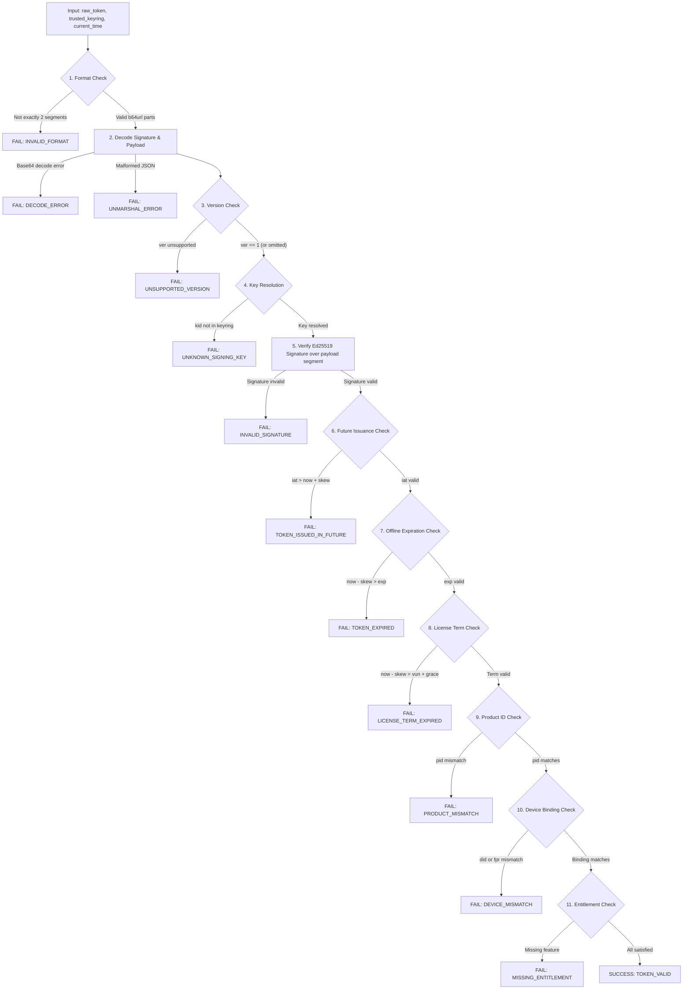

# Keygate Offline License Entitlement & Validation Specification (v1)

> **Status:** Approved Architecture & Security Specification  
> **Target Audience:** Cross-Platform Client SDK Authors, Cryptography Engineers, Security Auditors  
> **Applies to:** Keygate Offline License Verification Protocol  
> **Attribution:** *Powered by Keygate* (AGPL v3 Section 7(b))

---

## 1. Executive Summary & Design Rationale

Modern desktop, mobile, and embedded applications frequently run in disconnected or air-gapped environments—such as marine vessels, airplanes, field hospitals, secured government facilities, or developer workstations with intermittent connectivity. 

To provide uninterrupted software functionality without sacrificing commercial licensing controls, the Keygate ecosystem implements an **asymmetric, Ed25519-signed offline entitlement mechanism**.

### 1.1 Reuse & Enhancement of the Existing Format

Rather than introducing an incompatible proprietary format or heavyweight multi-header token structure, Keygate retains and refines its established two-part compact wire format:

$$\text{Token} = \text{base64url}(\text{Payload}) \,\|\, \text{"."} \,\|\, \text{base64url}(\text{Signature})$$

#### Why Symmetric HMAC is Explicitly Rejected
A common design flaw in software licensing is using symmetric HMAC (e.g. HMAC-SHA256). In symmetric schemes, the same secret key is required for both signing and verifying. Because client applications (desktop `.exe`, `.dmg`, `.so`) run on customer-controlled hardware, any embedded symmetric key can be extracted via decompilation (Ghidra, IDA Pro) or debugger memory inspection. Once extracted, an attacker can forge arbitrary valid license tokens for any customer.

#### Why Ed25519 Asymmetric Signatures are Used
Ed25519 (RFC 8032) establishes a strictly one-way cryptographic barrier:
- **Private Signing Keys** reside exclusively on the server (or hardware security module / KMS) and are **never** shipped in client software.
- **Public Verification Keys** are safely distributed to client applications, embedded at build time, or retrieved via `GET /api/v1/license/pubkey`. A customer possessing the public key can verify tokens with mathematical certainty but cannot forge signatures.

#### Format Improvements in Version 1.1
To resolve offline trust lifecycle gaps while maintaining 100% backward compatibility, two critical claims are standardized in the payload:
1. **`ver` (Token Format Version):** Explicit schema version (`"1"`), allowing future cryptographic or claim changes without silent verification failures.
2. **`kid` (Signing-Key Identifier):** Deterministic identifier for the server signing key (e.g., `key_bd4e02f43853c45c`), enabling seamless key rotation, overlap windows, and multi-key verification.

---

## 2. Token Format & Claim Specification

An offline token consists of two unpadded Base64URL-encoded (RFC 4648 §5) segments separated by a single ASCII period (`.`):

```text
<base64url-encoded-json-payload>.<base64url-encoded-ed25519-signature>
```

The signature is computed over the raw ASCII bytes of the first segment (`base64url(payload)`), ensuring unambiguous cross-platform verification regardless of how a client's JSON parser orders fields.

### 2.1 Complete Claims Reference

| Claim | Key | Type | Required | Description |
|---|---|---|---|---|
| **Version** | `ver` | `string` | **Yes** | Schema version. Current specification is `"1"`. (Tokens lacking this claim default to v1 for backward compatibility). |
| **Key ID** | `kid` | `string` | **Yes** | Server public key identifier (`key_` + 16 hex chars) used to sign this token. |
| **License ID** | `lid` | `string` | **Yes** | Unique identifier of the license in the Keygate database. |
| **Product ID** | `pid` | `string` | **Yes** | Unique product/application identifier (e.g., `prod_desktop_app`). |
| **Plan ID** | `pln` | `string` | No | Pricing or subscription plan identifier (e.g., `plan_enterprise_annual`). |
| **Status** | `sts` | `string` | **Yes** | License status at token issuance (`active`, `suspended`, `expired`, `revoked`). |
| **Device ID** | `did` | `string` | No | Bound client device identifier (e.g., `kgid:v1:darwin:...` or canonical UUID). |
| **Fingerprint** | `fpr` | `string` | No | Hex fingerprint binding `did` and `pid`: `hex(sha256(did + ":" + pid)[:8])`. |
| **Features** | `ftr` | `object` | No | Entitlements and boolean/scalar feature flags granted to this installation. |
| **Issued At** | `iat` | `integer`| **Yes** | Issuance timestamp as Unix epoch seconds. |
| **Expires At** | `exp` | `integer`| **Yes** | Offline token validity window (epoch seconds). Maximum duration client may stay offline. |
| **Valid Until**| `vun` | `integer`| No | License subscription term expiration (epoch seconds). Omitted/zero for perpetual licenses. |
| **Updates** | `upd` | `integer`| No | Maintenance cutoff date for perpetual licenses (epoch seconds). |
| **Grace Days** | `grc` | `integer`| No | Number of grace days permitted after `vun` before the client must halt execution. |
| **Nonce** | `nce` | `string` | **Yes** | Cryptographically random unique string per issuance to prevent replay. |

### 2.2 Example Token Payload

```json
{
  "ver": "1",
  "kid": "key_bd4e02f43853c45c",
  "lid": "lic_99a8b7c6d5e4",
  "pid": "prod_cad_designer",
  "pln": "plan_studio_yearly",
  "sts": "active",
  "did": "kgid:v1:darwin:5581b5a7b290e096fdea9b19916561e13d15fc983a9b57c53a9e5ad91f29f4b7",
  "fpr": "a4f801bc29e371d0",
  "ftr": {
    "3d_rendering": true,
    "max_export_resolution": 8192,
    "team_collaboration": true
  },
  "iat": 1776500000,
  "exp": 1779092000,
  "vun": 1808036000,
  "upd": 1808036000,
  "grc": 7,
  "nce": "q7B_x9mE3_2lK0pA"
}
```

---

## 3. Conforming Client Validation Algorithm

A conforming client SDK or application in any language must validate offline tokens using the following step-by-step procedure:



### Detailed Validation Rules

1. **Segment Delimitation:**
   - The token string must contain exactly one period (`.`), separating the base64url payload from the base64url signature.
   - If `.` is missing or more than one `.` is present, reject immediately with `ErrInvalidFormat`.
2. **Signature Decoding:**
   - Decode the signature using unpadded Base64URL.
   - The decoded signature length must be exactly 64 bytes (`ed25519.SignatureSize`).
3. **Payload Decoding & Deserialization:**
   - Decode the payload using unpadded Base64URL.
   - Parse as UTF-8 JSON into a claims object.
4. **Version Gating:**
   - If `ver` is present, it must equal `"1"`. If higher major versions are encountered, reject with `ErrUnsupportedVersion`.
5. **Key Resolution:**
   - If `kid` is present, look up the public key in `trusted_keyring[kid]`. If not found, reject with `ErrUnknownSigningKey`.
   - If `kid` is omitted (legacy token), select the fallback or pinned public key.
6. **Cryptographic Verification:**
   - Verify the 64-byte Ed25519 signature against the raw ASCII bytes of the first segment (`base64url(payload)`) using the resolved 32-byte public key.
   - **Fail closed:** If `ed25519.Verify` returns false, reject with `ErrInvalidSignature`. Do not inspect any further claims.
7. **Time & Expiration Verification:**
   - Allow a standard clock skew tolerance ($\Delta t = 60\text{s}$ recommended) to accommodate minor drift:
     $$\text{Future Check: } \text{iat} \le \text{now} + \Delta t$$
     $$\text{Offline Window Check: } \text{now} - \Delta t \le \text{exp}$$
     $$\text{License Term Check: } \text{now} - \Delta t \le \text{vun} + (\text{grc} \times 86400)$$
8. **Product & Device Binding:**
   - If `ExpectedProductID` is configured, assert `token.pid == ExpectedProductID`.
   - If `ExpectedIdentifier` is configured:
     - Assert `token.did == ExpectedIdentifier`.
     - Compute $\text{expected\_fpr} = \text{hex}(\text{sha256}(\text{did} + \text{":"} + \text{pid})[:8])$ and assert `token.fpr == expected_fpr`.
9. **Feature & Entitlement Enforcement:**
   - Check that requested feature flags exist in `token.ftr` and evaluate to truthy values.

---

## 4. Offline Trade-Offs & Security Boundaries

Operating without continuous network access involves inherent trade-offs between customer convenience and licensing enforcement. Conforming applications must account for the following real-world boundaries:

### 4.1 Maximum Permitted Offline Duration (`exp`)

- **Definition:** The `exp` claim dictates how long a client may operate disconnected before it is required to contact Keygate (`POST /api/v1/license/verify`) to obtain a refreshed token.
- **Plan Configuration:** Controlled per plan via `TokenTTLDays` (e.g. 7 days, 14 days, 30 days).
- **Enforcement:** Once $\text{now} > \text{exp}$, the client must refuse feature access or enter a restricted read-only mode until a network connection is established and the token renewed.

### 4.2 Renewal Policy & Background Check-in

- Client applications should initiate background token refresh attempts when $\ge 50\%$ of the offline window has elapsed.
- For example, with a 14-day token, the client attempts renewal once 7 days have passed whenever network connectivity is detected. This prevents users from unexpectedly running into expiration during brief connectivity losses.

### 4.3 Grace Period Behavior (`grc` after `vun`)

- For subscription-based licenses, `vun` (Valid Until) marks the contractual billing end date.
- The server grants a grace period (e.g. 3–7 days via `grc`) to accommodate delayed credit card renewals or cross-border payment processing.
- The effective offline deadline is $\text{min}(\text{exp}, \text{vun} + (\text{grc} \times 86400))$.

### 4.4 Local Clock Manipulation Limitations

> [!WARNING]
> **Adversary Rolling Back the Local System Clock:**  
> If an attacker turns back their computer clock (e.g., from 2027 to 2026), a naive client relying solely on `gettimeofday()` might continue to treat an expired token as valid.

To mitigate local clock tampering without network access:
1. **Monotonic Forward Latch:** The client application persists the highest timestamp observed (`last_seen_timestamp`) in secure local storage (e.g., macOS Keychain, Windows DPAPI, Linux encrypted state).
2. **Rollback Detection:** If $\text{system\_now} < \text{last\_seen\_timestamp} - \text{tolerance}$, clock tampering is detected. The application immediately locks offline access until an authenticated network check-in occurs.
3. **OS Monotonic Clocks:** On macOS/iOS use `clock_gettime(CLOCK_MONOTONIC_RAW)`, on Windows use `QueryPerformanceCounter()`, and on Linux use `clock_gettime(CLOCK_BOOTTIME)` to measure elapsed uptime independently of wall-clock changes.

### 4.5 Disconnected Revocation Delay

> [!IMPORTANT]
> **No Cryptographic Revocation Without Connectivity:**  
> A disconnected client cannot receive an out-of-band revocation signal. If a license is cancelled, refunded, or suspended on the server, an offline client will remain functional until its current `exp` timestamp expires.  
> Operators requiring tighter revocation bounds must configure shorter `TokenTTLDays` (e.g., 24–48 hours) for high-risk accounts.

### 4.6 Verification Key Unavailability

- Conforming SDKs must bundle the initial public verification key (`license_pubkey`) at compile time.
- If an offline client has no stored key and cannot connect to `/license/pubkey`, it fails closed (`ErrKeyNotInitialised`).
- Verified keys received during online operations must be cached locally in persistent storage.

---

## 5. Key Rotation & Multi-Key Keyring Strategy

Keygate supports seamless signing key rotation without stranding active installations or requiring emergency application updates.

```mermaid
sequenceDiagram
    participant Admin as Operator / Admin
    participant Srv as Keygate Server
    participant DB as Key Store
    participant Client as Offline Client

    Note over Admin,Srv: Phase 1: Key Generation & Registration
    Admin->>Srv: Provision new Ed25519 Key (key_2027_01)
    Srv->>DB: Insert new key as active; mark old key as retired

    Note over Srv,Client: Phase 2: Overlap Window (max_offline_ttl)
    Client->>Srv: POST /license/verify
    Srv->>Client: Token signed with key_2027_01 (kid: key_2027_01)
    Client->>Srv: GET /license/pubkey
    Srv-->>Client: 200 OK (keyring: active key_2027_01 + retired key_2026_01)
    Client->>Client: Store both keys in local keyring

    Note over Client: Phase 3: Offline Verification
    Client->>Client: Inspect token kid
    Client->>Client: Select matching key from keyring
    Client->>Client: Verify signature -> SUCCESS
```

### Overlap Drain Window Policy
1. When a new key is introduced, the previous key is moved to `retired` status rather than immediately deleted.
2. The server's `/license/pubkey` endpoint serves the union of the active key and all recently retired keys whose maximum offline window (`max(TokenTTLDays)`) has not yet elapsed.
3. Client keyrings maintain the union of trusted public keys, indexing by `kid`. Old tokens verify against the retired key; freshly issued tokens verify against the active key.
4. Once the overlap window expires, the retired key is safely decommissioned.
