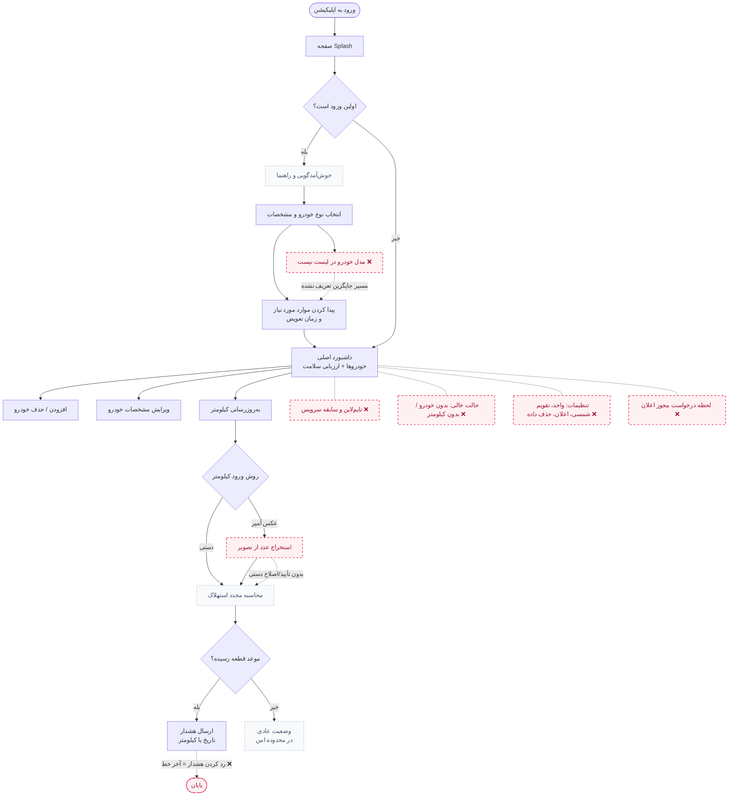
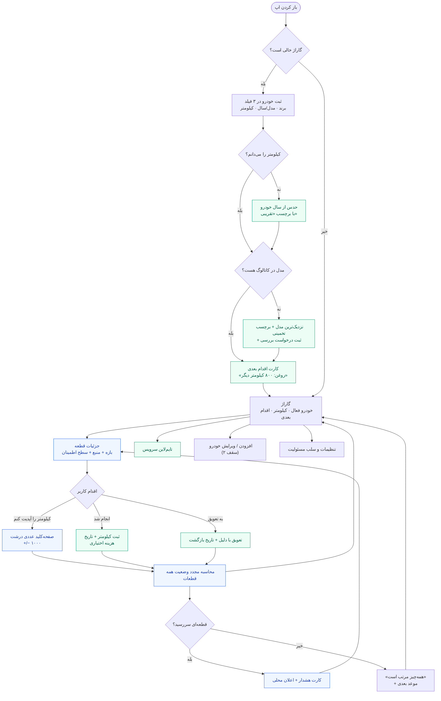
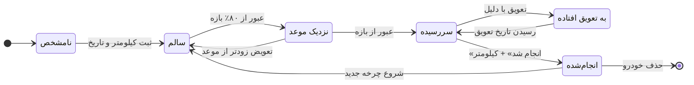

# فلوی اپلیکیشن نگهداری خودرو

> دو نمودار: **فلوی فعلی** (همان که فرستادی، بازکشیده و شکاف‌هایش علامت‌خورده) و **فلوی پیشنهادی MVP**.
> علامت ❌ = گره یا مسیری که در طرح فعلی وجود ندارد و باعث شکستن تجربه می‌شود.

---

## ۱. فلوی فعلی (بازکشی‌شده)

### شکاف‌های این فلو

| # | شکاف | چرا می‌شکند |
|---|---|---|
| ۱ | **مدل خودرو پیدا نشد** | بن‌بست کامل. باید «نزدیک‌ترین مدل + برچسب تخمینی» داشته باشد. |
| ۲ | **کیلومتر نامعلوم** | فیلد اجباری. باید «نمی‌دانم» با حدس از سال خودرو. |
| ۳ | **رد کردن هشدار** | بدون «به تعویق انداختن» با دلیل و تاریخ، کاربر هشدار را خاموش می‌کند. |
| ۴ | **«انجام شد» وجود ندارد** | بدون آن، چرخه بعدی از کجا شروع شود؟ این حلقه، قلب محصول است. |
| ۵ | **سابقه سرویس** | بدون تاریخچه، اپ هیچ‌وقت نمی‌داند دفعه قبل کِی بود؛ همه محاسبات حدس می‌شوند. |
| ۶ | **حالت خالی و مجوز اعلان** | کاربر بدون خودرو یا با اعلان ردشده، به بن‌بست می‌رسد. |
| ۷ | **OCR بدون تأیید** | عدد غلط، مبنا همه محاسبات را خراب می‌کند و بی‌اعتمادی می‌سازد. |
| ۸ | **Splash + کوییز قبل از ارزش** | کاربر هنوز نفهمیده چه می‌گیرد، باید ۵ قدم ثبت‌نام طی کند. |

---

## ۲. فلوی پیشنهادی MVP

تفاوت اصلی: **هیچ ثبت‌نامی نیست، هیچ Splashی نیست، و ارزش در ۶۰ ثانیه دیده می‌شود.**

**قاعده اعلان:** کیلومتر را به تاریخ تبدیل کن — `روزهای باقی‌مانده = (کیلومتر موعد − کیلومتر فعلی) ÷ میانگین کیلومتر روزانه`. اعلان محلی، حداکثر یکی در هفته، با یک دکمه اصلی.

---

## ۳. چرخه عمر یک قطعه

**قاعده نمایش:** همیشه سه چیز با هم نشان داده شود — بازه، منبع، و سطح اطمینان. یک رنگ قطعی بدون منبع، ادعای بی‌پشتوانه است.

| وضعیت | رنگ | جمله پیشنهادی |
|---|---|---|
| سالم | سبز | «تا حدود ۲٬۳۰۰ کیلومتر دیگر» |
| نزدیک | زرد | «برنامه‌ریزی کن؛ حدود ۴۰۰ کیلومتر مانده» |
| سررسید | قرمز | «گذشته از موعد — تا ۱٬۰۰۰ کیلومتر دیگر بی‌خطر است» |
| نامشخص | خاکستری | «کیلومترت را ثبت کن تا دقیق حساب کنم» |
