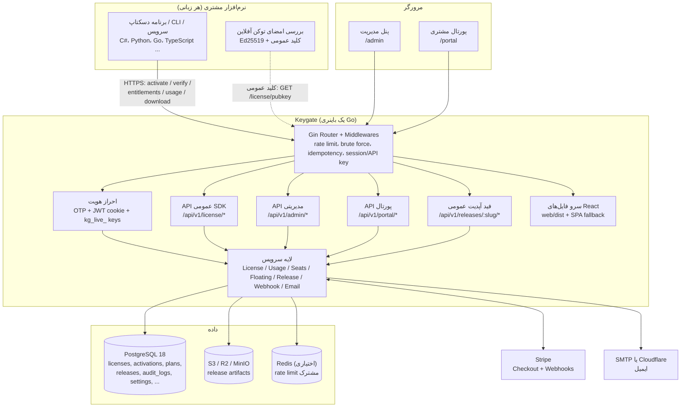
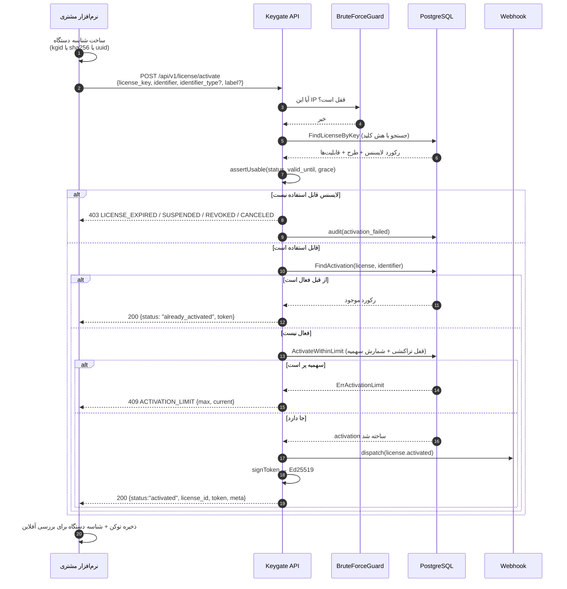
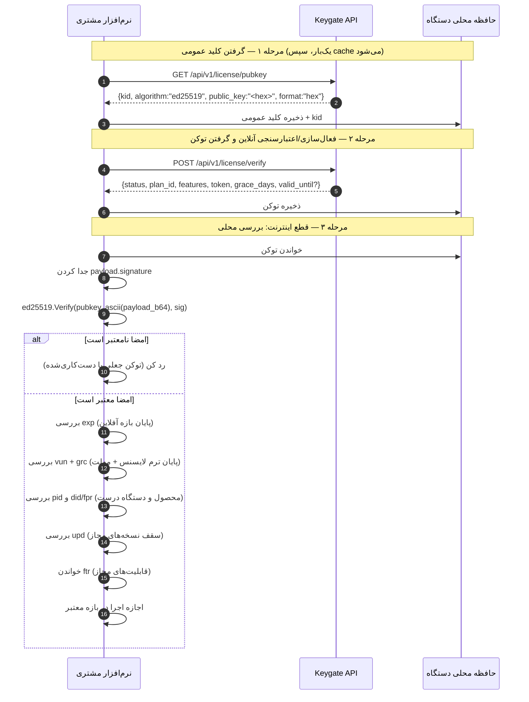
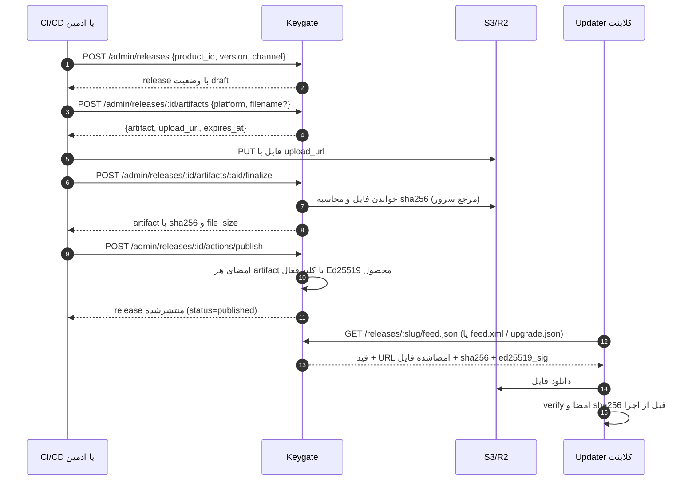

# معماری Keygate

این سند ابتدا معماری را ساده و بعد فنی توضیح می‌دهد. تمام اجزای نام‌برده‌شده در کد واقعی همین مخزن وجود دارند.

---

## ۱. در یک نگاه ساده

Keygate سه بازیگر دارد:

1. **نرم‌افزار مشتری (Client / App)**: برنامه‌ای که کاربر اجرا می‌کند. با کلید لایسنس به Keygate می‌گوید «من کی هستم و روی چه دستگاهی اجرا می‌شوم» و در ازای آن **توکن امضاشده** می‌گیرد.
2. **اپراتور شما (Admin)**: با پنل مدیریت محصول، طرح، لایسنس، نسخه، کلید امضا و تنظیمات را اداره می‌کند.
3. **خریدار (Customer)**: با پورتال مشتری لایسنس‌های خودش، دستگاه‌های فعال، تیم، صورتحساب و تمدید را می‌بیند.

سرور Keygate در وسط می‌ایستد و این کارها را می‌کند: نگه‌داشتن وضعیت لایسنس در PostgreSQL، صدور توکن آفلاین، سرو کردن فید آپدیت، و نگه‌داشتن فایل‌های نسخه روی ذخیره‌سازی S3.

## ۲. تصویر کلی معماری

## ۳. اجزای فنی

### ۳.۱ فرانت‌اند (`web/`)

* React 19 + Vite 8 + TypeScript + Tailwind 4 + TanStack Query + React Router 7.
* خروجی build در `web/dist` قرار می‌گیرد و **توسط خود باینری Go سرو می‌شود** (`serveFrontend` در `cmd/server/main.go`). مسیرهای `/api/`, `/pay/`, `/health`, `/metrics`, `/docs` به روتر می‌رسند و هر مسیر دیگری فایل استاتیک یا `index.html` است.
* نام فایل‌های زیر `/assets/` هش محتوا دارد و `Cache-Control: immutable` می‌گیرند؛ `index.html` همیشه `no-cache` است.
* صفحه‌های ادمین در `web/src/pages/admin/` و پورتال در `web/src/pages/portal/` هستند (فهرست کامل در [admin-panel-guide.md](admin-panel-guide.md)).
* کلاینت HTTP در `web/src/lib/api.ts` است و پوشش `{success, data}` سرور را در همان‌جا باز می‌کند.

### ۳.۲ بک‌اند (`cmd/server`, `internal/`)

* Gin، مدل‌سازی با **bun** روی `pgdriver`، PostgreSQL 18.
* تمام routeها در `cmd/server/main.go` ثبت می‌شوند: **۱۵۰ ثبت مسیر** به‌علاوه‌ی `StaticFile("/docs/openapi.yaml")` (جزئیات شمارش در [documentation-audit.md](documentation-audit.md)).
* تفکیک گروه‌ها بر اساس مدل اعتماد:
  * `/api/v1/license/*` — عمومی؛ **کلید لایسنس خودش اعتبارنامه است**.
  * `/api/v1/releases/:product_slug/*` — فید عمومی؛ اعتماد از امضای فایل می‌آید نه از مخفی بودن URL.
  * `/api/v1/portal/*` — نشست مشتری (کوکی).
  * `/api/v1/admin/*` — نشست ادمین یا API key با scope مناسب.
* پردازش‌های پس‌زمینه در `main.go`: پاک‌سازی نشست‌های floating منقضی، ارسال صف ایمیل، اجرای بررسی‌های انقضا، همگام‌سازی مصرف با Stripe، تلاش مجدد webhook، و اسنپ‌شات تحلیلی.

### ۳.۳ پایگاه داده

PostgreSQL؛ جدول‌های اصلی: `users`, `products`, `plans`, `entitlements`, `licenses`, `activations`, `seats`, `usage_events`, `usage_counters`, `addons`, `license_addons`, `floating_sessions`, `releases`, `release_artifacts`, `release_signing_keys`, `audit_logs`, `webhooks`, `webhook_deliveries`, `subscriptions`, `settings`, `otp_codes`, `refresh_tokens`, `email_queue`, `idempotency_keys`, `analytics_snapshots`, `metered_billing`, `license_renewals`, `plan_update_terms`, `schema_migrations`.

نکته‌ی کلیدی: ستون `licenses.license_key` مقدار **هش SHA-256** کلید را نگه می‌دارد و نسخه‌ی رمزنگاری‌شده‌ی کلید در `license_key_encrypted` است (`AES-256-GCM` با کلید مشتق‌شده از `RELEASE_KEY_ENCRYPTION_KEY`). مدل `model.License` فیلد کلید را با `json:"-"` مخفی می‌کند تا به‌طور تصادفی از یک پاسخ مدیریتی بیرون نریزد.

### ۳.۴ ذخیره‌سازی فایل انتشار

پشته‌ی S3 (`internal/storage`) با پشتیبانی از R2/S3/MinIO و `STORAGE_FORCE_PATH_STYLE`. آپلود از مرورگر با presigned PUT انجام می‌شود، سپس سرور خودش فایل را از باکت می‌خواند و `sha256` رسمی را محاسبه می‌کند (`FinalizeArtifact`) — یعنی هش اعلامی کلاینت، «حقیقت» نیست.

### ۳.۵ احراز هویت

* مشتری/ادمین انسانی: کد یک‌بارمصرف ۶ رقمی با ایمیل (`/auth/otp/send`, `/auth/otp/verify`) → کوکی نشست ۲۴ ساعته + کوکی refresh با عمر ۳۰ روز و مسیر محدود `/api/v1/auth/refresh`.
* سرور به سرور: کلید API با پیشوند `kg_live_` و scopeهای `admin` / `licenses:write` / `releases:write`.
* SDK عمومی: هدر یا بدنه‌ی حاوی `license_key` (و برای فیدها، `X-License-Key` یا توکن امضاشده).
* جزئیات کامل در [authentication-and-security.md](authentication-and-security.md).

### ۳.۶ SDKها

| مسیر | زبان | وضعیت |
| --- | --- | --- |
| `sdk/python` | Python | موجود؛ بدون وابستگی خارجی (پیاده‌سازی خالص Ed25519)؛ چند ناسازگاری قراردادی دارد |
| `examples/dotnet/Keygate.Sample` | C#/.NET | نمونه‌ی آموزشی این مخزن؛ SDK رسمی وجود ندارد |
| `internal/license` + `pkg/integrity` | Go | مرجع رسمی امضا/بررسی |

هیچ کد Go برای کلاینت منتشر نشده است؛ API زبانی‌مستقل است و قرارداد آن در [api-reference.md](api-reference.md) آمده است.

## ۴. جریان فعال‌سازی لایسنس (Activation)

نکته‌های مهم این جریان، همه مستخرج از `internal/service/license.go`:

* محدودیت تعداد دستگاه به‌صورت **اتمی و تراکنشی** اعمال می‌شود؛ دو درخواست هم‌زمان نمی‌توانند از سقف رد شوند.
* اگر کلاینت `previous_identifier` بفرستد، فعال‌سازی قدیمی **درجا منتقل** می‌شود و سهمیه‌ی اضافی مصرف نمی‌شود (مهاجرت طرح شناسه).
* `Activate` وضعیت دقیق را برمی‌گرداند؛ برخلاف `Verify` که همه‌ی حالت‌ها را در `404` جمع می‌کند.

## ۵. جریان اعتبارسنجی آفلاین (Offline Verification)

کلید خصوصی امضا **هرگز** از سرور خارج نمی‌شود؛ فقط کلید عمومی منتشر می‌شود. جزئیات دقیق ساختار توکن در [offline-licensing-guide.md](offline-licensing-guide.md).

## ۶. جریان انتشار نسخه و آپدیت

* ترتیب چک‌ها در انتشار (`ReleaseService.Publish`): همه‌ی artifactها باید آپلود شده باشند → اگر `require_signing` روشن است، کلید فعال اجباری است (وگرنه `409`) → emit امضا → تغییر وضعیت.
* اگر محصول کلید امضا نداشته باشد و `require_signing=false` باشد، نسخه **عمداً unsigned** منتشر می‌شود و امضاهای قبلی حذف می‌شوند (تا کلاینت امضای کلید بازنشسته را نبیند).
* مانیفست صحت فایل‌ها (`Integrity Manifest`) بخشی از این جریان نیست و ابزار جداگانه‌ای است — بخش ۷ را ببینید.

## ۷. مانیفست صحت فایل‌ها (Integrity Manifest)

`cmd/keygate-manifest` یک CLI مستقل است (`create` / `verify` / `inspect`) که با `pkg/integrity` کار می‌کند: فایل‌های یک پوشه را هش می‌کند، مانیفست را کانونیکال می‌کند، با Ed25519 امضا می‌کند و در یک پوش `keygate-integrity-v1` می‌گذارد. مهم: **هیچ endpoint سروری این مانیفست را نمی‌سازد، امضا نمی‌کند یا توزیع نمی‌کند.** برای یکپارچه‌سازی نیاز به تصمیم تیم است. جزئیات در [integrity-and-release-guide.md](integrity-and-release-guide.md).

## ۸. کدام بخش‌ها زبانی‌مستقل‌اند و کدام وابسته به SDK؟

| بخش | زبانی‌مستقل؟ | توضیح |
| --- | --- | --- |
| فراخوانی `activate` / `verify` / `deactivate` | ✅ | فقط HTTP + JSON؛ در C#، Python، Go، TypeScript و … یکسان |
| بررسی امضای توکن آفلاین | ✅ | به کتابخانه‌ی Ed25519 در زبان خودتان نیاز دارد (مثلاً `System.Security.Cryptography` یا `cryptography`) |
| `entitlements` / `usage` | ✅ | JSON خالص |
| فیدهای آپدیت | ✅ | قالب‌های Sparkle / Velopack / Tauri استاندارد صنعت هستند |
| بررسی امضای artifact | ✅ از نظر الگوریتم (Ed25519) | اما **قالب امضای Tauri** یک فایل minisign است؛ اگر از آپدیت‌کننده‌ی Tauri استفاده می‌کنید، ابزار خودش این کار را می‌کند |
| مانیفست صحت | ⚠️ | قرارداد JSON مشخص است، اما ابزار مرجع فقط به‌صورت CLI Go وجود دارد |
| SDK رسمی | ❌ | SDK دات‌نت رسمی وجود ندارد؛ نمونه‌ی `examples/dotnet` آموزشی است |

## ۹. خطاها و «پوشش» پاسخ‌ها در یک نگاه

هر پاسخ موفق `200/201` با پوشش `{"success": true, "data": ...}` می‌آید و هر خطا با `{"success": false, "error": {"code", "message", "details?"}}`. لیست‌ها همیشه `total`، `limit` و `offset` را هم برمی‌گردانند و یک مجموعه‌ی خالی به‌صورت `[]` برمی‌آید، نه `null`. مستثناها: فیدها (XML/JSON خام و ساختار Velopack/Tauri)، `204` در Tauri وقتی آپدیتی نیست، و `/health`, `/metrics`, `/docs`.
