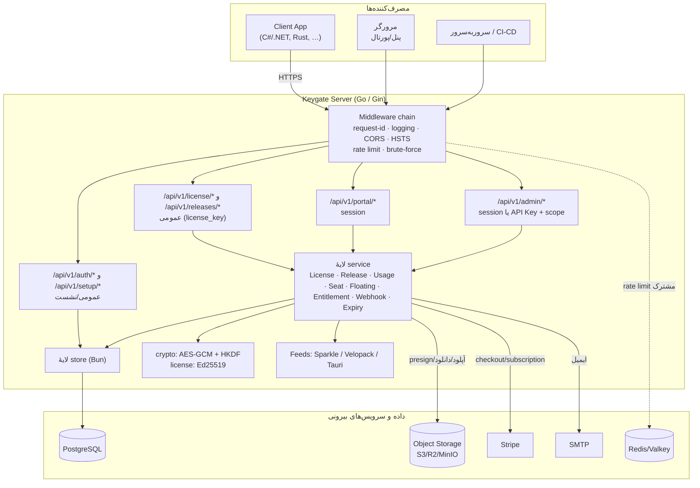
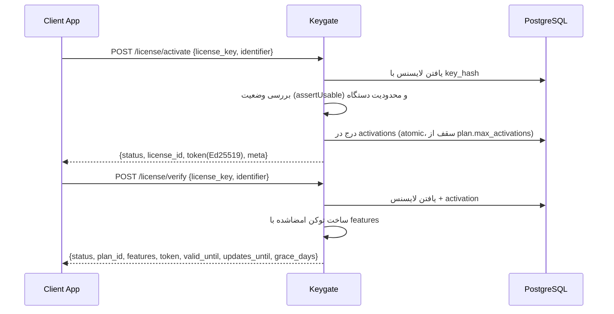
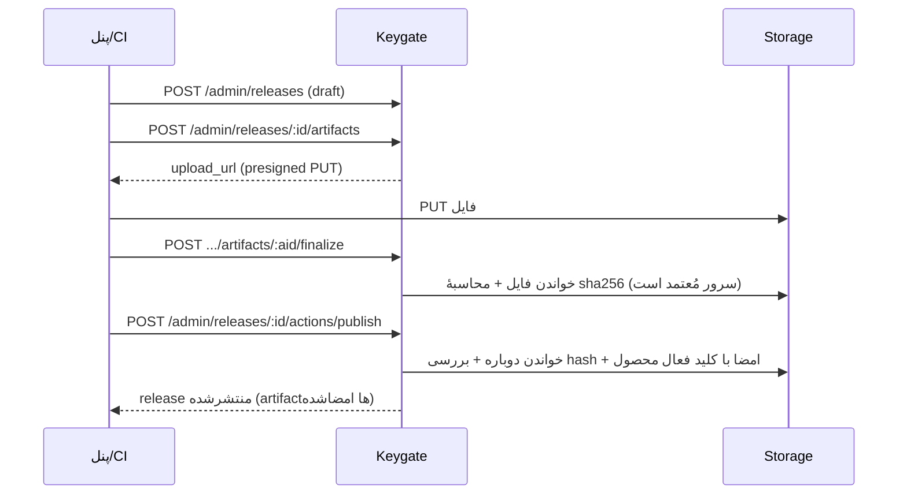

# معماری Keygate

این سند معماری واقعی سیستم را بر پایهٔ کد همین مخزن توضیح می‌دهد. هرجا رفتاری صرفاً پیشنهادی و
پیاده‌سازی‌نشده باشد، صریحاً با عنوان «پیشنهاد» مشخص شده است.

---

## ۱. نمای ساده

Keygate یک سرور Go است که سه نوع مصرف‌کننده دارد:

1. **نرم‌افزار مشتری (Client App)** — با `license_key` مستقیم به `/api/v1/license/*` و
   `/api/v1/releases/*` وصل می‌شود. اینها عمومی‌اند و به کلید API نیاز ندارند.
2. **کاربر انسانی** — از طریق مرورگر وارد `/api/v1/portal/*` (پورتال مشتری) یا
   `/api/v1/admin/*` (پنل مدیریت) می‌شود. احراز هویت با **session (JWT در کوکی)** انجام می‌شود.
3. **سیستم‌های سرور‌به‌سرور** — مثل backend فروشگاه مشتری یا CI/CD، که با **API Key** به
   `/api/v1/admin/*` وصل می‌شوند.

به‌علاوه، سرویس‌های بیرونی: **PostgreSQL**، **object storage** (اختیاری)، **Stripe** (اختیاری)،
**SMTP** (اختیاری) و **Redis** (اختیاری).

---

## ۲. نمودار اجزا (Mermaid)



---

## ۳. زنجیرهٔ middleware

همهٔ درخواست‌ها از یک زنجیرهٔ مشترک عبور می‌کنند (به‌ترتیب، بر پایهٔ `cmd/server/main.go`):

* **request-id** و **logging** (لاگ دسترسی؛ مقادیر حساس مثل کلید لایسنس در query redact می‌شوند).
* **بازگردانی از panic** و پاسخ همیشه در قالب envelope.
* **CORS**: فقط برای `Origin`های مجاز؛ در production فقط `BASE_URL`.
* **هدرهای امنیتی**: در محیط TLS هدر `Strict-Transport-Security` ست می‌شود.
* **محدودیت نرخ (RateLimitByIPScoped)**: هر «خانوادهٔ مسیر» سبد جدا دارد
  (`license`، `feed`، `auth`، `otp_send`، `auth_refresh`، `invites`، `public_plans`،
  `stripe_webhook`، `checkout_verify`، `admin`). اگر `REDIS_URL` ست باشد، سبدها بین نمونه‌ها
  مشترک می‌شوند؛ وگرنه هر نمونه جداگانه در حافظه می‌شمارد.
* **محافظت از حدس زدن** (`LicenseBruteForceGuard`) روی گروه `/license/*`.

سپس هر گروه، middleware اختصاصی خود را دارد:

| گروه | احراز هویت | scope لازم |
|---|---|---|
| `/license/*` | `license_key` در بدنه | — (عمومی) |
| `/releases/:slug/*` | عمومی | — |
| `/auth/*` | عمومی (به‌جز logout که session می‌خواهد) | — |
| `/portal/*` | `SessionAuth` | — (فقط session) |
| `/admin/*` (گروه `admin`) | `SessionOrAPIKey` | `admin` |
| `/admin/*` (گروه `licWrite`) | `SessionOrAPIKey` | `admin` یا `licenses:write` |
| `/admin/*` (گروه `relWrite`) | `SessionOrAPIKey` | `admin` یا `releases:write` |

نکته: `/admin/products/:id/signing-key*` عمداً فقط در گروه `admin` هستند؛ چرخش کلید امضا یک
عملیات اپراتوری است و نباید با کلید CI انجام شود.

---

## ۴. جریان‌های اصلی

### ۴.۱ فعال‌سازی و اعتبارسنجی (آنلاین)



* در `Activate` اگر دستگاه از قبل فعال باشد، پاسخ `already_activated` است (نه خطا).
* عبور از سقف دستگاه → خطای `ACTIVATION_LIMIT` با `details` شامل `{current, max}`.
* در `Verify` همهٔ حالت‌های «لایسنس قابل‌استفاده نیست» (منقضی/معلق/لغو/دستگاه نامعتبر) به
  **همان `404 LICENSE_NOT_FOUND`** تبدیل می‌شوند تا endpoint به oracle تشخیص کلید تبدیل نشود.

### ۴.۲ توکن آفلاین

`activate` و `verify` هرکدام یک `token` برمی‌گردانند که با **Ed25519** امضا شده است:

```
token = base64url(payload_json) . base64url(signature)
```

* امضای دیجیتال روی **بایت‌های همان نیمهٔ اول (رشتهٔ base64)** محاسبه می‌شود، نه روی JSON خام.
* کلاینت یک‌بار کلید عمومی را از `GET /api/v1/license/pubkey` می‌گیرد و بدون شبکه اعتبارسنجی می‌کند.
* جزئیات کامل در `offline-licensing-guide.md`.

### ۴.۳ لایسنس شناور

`license_model=floating` روی پلن، سقف را از «دستگاه» به «جلسهٔ هم‌زمان» تغییر می‌دهد:

* `POST /license/floating/checkout` یک جلسه با انقضای `floating_timeout` دقیقه می‌سازد.
* `POST /license/floating/heartbeat` جلسه را تمدید می‌کند.
* `POST /license/floating/checkin` جلسه را آزاد می‌کند.
* یک حلقهٔ پس‌زمینه جلسه‌های منقضی را پاک می‌کند (`FloatingService.StartCleanupLoop`).

### ۴.۴ انتشار نسخه و صحت فایل



* `sha256` توسط **سرور** محاسبه و تثبیت می‌شود؛ مقدار ارسالی کلاینت فقط برای تطبیق است
  (خطای `SHA256_MISMATCH`).
* اگر `require_signing` محصول روشن باشد و کلید فعالی نباشد، publish با
  `SIGNING_NOT_CONFIGURED` رد می‌شود.
* جزئیات در `integrity-and-release-guide.md`.

### ۴.۵ مدیریت کلید امضا

* کلید خصوصی هر محصول با **AES-256-GCM** و AAD برابر `product_id` رمزنگاری می‌شود
  (کلید master از `RELEASE_KEY_ENCRYPTION_KEY`).
* در هر لحظه فقط یک کلید فعال برای هر محصول وجود دارد (index یکتای جزئی).
* `rotate` کلید قبلی را غیرفعال و کلید تازه را فعال می‌کند؛ کلید عمومی از
  `…/signing-key/public.pem` (PEM با block type `ED25519 PUBLIC KEY`) و
  `…/signing-key/tauri-pubkey` (قالب minisign) قابل دریافت است.

---

## ۵. لایه‌های نرم‌افزار

| لایه | مسئولیت | نمونه فایل |
|---|---|---|
| `cmd/server` | سیم‌کشی، ثبت مسیرها، اجرای migration، خاموشی تمیز | `main.go` |
| `internal/handler` | تفسیر HTTP، اعتبارسنجی ورودی، قالب پاسخ | `license.go`, `admin.go`, `release_public.go` |
| `internal/middleware` | auth، scope، idempotency، rate limit، brute-force | `auth.go`, `idempotency.go`, `ratelimit.go` |
| `internal/service` | منطق دامنه، تراکنش‌ها، webhook، ایمیل | `license.go`, `release.go`, `usage.go` |
| `internal/store` | کوئری‌های Bun و اجرای migration | `store.go`, `admin.go`, `analytics.go` |
| `internal/model` | ساختارهای داده و ثابت‌ها | `model.go` |
| `internal/license` | تولید کلید و امضا/بررسی توکن | `keygen.go`, `token.go` |
| `internal/crypto` | AES-GCM و HKDF | `aesgcm.go`, `hkdf.go` |
| `internal/payment` | Stripe و fulfillment | `fulfill.go` و… |
| `internal/storage` | انتزاع S3 با presign | `s3.go` |
| `pkg/deviceid` | شناسهٔ دستگاه v1، هش مؤلفه‌ها، drift scoring، proof-of-possession (فعلاً فقط اعتبارسنجی قالب در سرور استفاده می‌شود) | `deviceid.go` |
| `pkg/integrity` | ساخت/امضای/بررسی مانیفست `keygate-integrity-v1` | `manifest.go`, `signer.go`, `verifier.go` |
| `cmd/keygate-manifest` | CLI مستقل برای `create` / `verify` / `inspect` مانیفست | `main.go` |
| `sdk/python` | کلاینت مرجع پایتون (بدون وابستگی خارجی) | `keygate/client.py`, `offline.py`, `manifest.py` |

### ۵.۱ چرخهٔ عمر activation

```
activate ──▶ status=active ──(client/portal/admin/transfer)──▶ status=deactivated
                    ▲                                                │
                    └────────────── reactivate ◀─────────────────────┘
```

* فقط ردیف‌های `active` در سهم پلن شمرده می‌شوند؛ ردیف `deactivated` یک tombstone قابل
  بازرسی است.
* `DELETE /admin/activations/:id` هم به tombstone تبدیل می‌کند (نه حذف فیزیکی).
* revoke/expire مسیرهای خودشان را دارند و همچنان hard delete می‌کنند.

---

## ۶. چه چیزی مستقل از زبان است و چه چیزی به کلاینت خاص وابسته؟

**مستقل از زبان (قرارداد HTTP/JSON):**

* همهٔ endpointهای `/api/v1/*` — با هر زبان و کتابخانه‌ای قابل فراخوانی‌اند.
* توکن آفلاین — یک قرارداد سادهٔ `base64url.payload.signature` با امضای Ed25519 که در هر زبانی
  (C#، Python، Rust، Go، …) قابل بررسی است، چون Ed25519 استاندارد است.
* فیدها — سه قالب صنعتی: Sparkle (XML)، Velopack (JSON)، Tauri (JSON).

**وابسته به کلاینت/ابزار خاص:**

* **Sparkle** — فقط macOS/iOS؛ فیلد `sparkle:edSignature` باید base64 خام امضای ۶۴‌بایتی باشد.
* **Velopack** — کلاینت .NET؛ بر SHA-256 (hex بزرگ) و HTTPS تکیه می‌کند و امضا را بررسی نمی‌کند.
* **Tauri** — امضای **minisign** می‌خواهد (envelope خاص با trusted comment + global signature)؛
  Keygate آن را در فیلد `tauri_signature` می‌سازد.
* **SDK پایتون** (`sdk/python`) به‌عنوان مرجع در مخزن هست؛ برای زبان‌های دیگر باید مستقیماً با
  API کار کرد (قرارداد HTTP/JSON در `api-reference.md`).
* **`cmd/keygate-manifest`** به Go وابسته است ولی خروجی JSON آن (`keygate-integrity-v1`) در هر
  زبانی قابل بررسی است.

---

## ۷. موازی‌سازی و پایداری

* عملیات حساس (فعال‌سازی، افزایش سهمیه، checkout شناور، افزودن صندلی) با **قفل سطح‌ردیف** و
  تراکنش، در سطح دیتابیس اتمیک شده‌اند تا دو درخواست هم‌زمان سقف را رد نکنند.
* `Idempotency-Key` روی `activate`، `usage`، `floating/checkout` اثر تکرار را حذف می‌کند
  (TTL ۲۴ ساعت).
* حلقه‌های پس‌زمینه: پاک‌سازی جلسه‌های شناور، بررسی انقضا/یادآوری‌ها، همگام‌سازی مصرف Stripe،
  و backfill امضای Tauri برای artifactهای قدیمی.

## ۸. آنچه پیاده‌سازی نشده است

* Keygate SDK رسمی برای زبان‌ها ندارد؛ فقط قرارداد HTTP.
* «مانیفست صحت» به‌صورت یک فایل امضاشدهٔ مستقل وجود ندارد؛ صحت از طریق `sha256` هر artifact در
  فید + امضای Ed25519/Minissign همان artifact تأمین می‌شود. این تمایز در
  `documentation-audit.md` ثبت شده است.
* چرخش خودکار `RELEASE_KEY_ENCRYPTION_KEY` وجود ندارد؛ نیازمند اسکریپت دستی بازرمزنگاری است.
